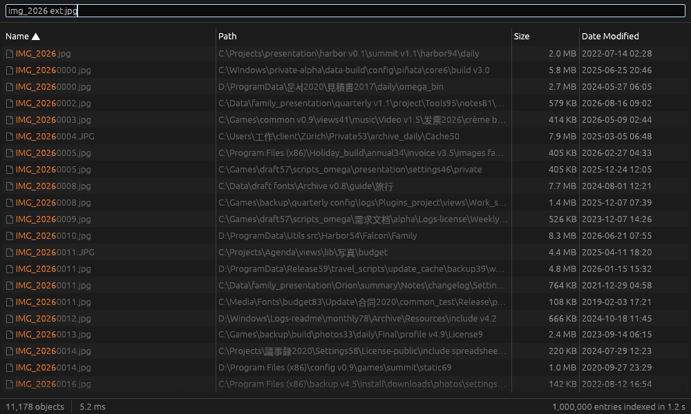

# Fennec

*Find anything in a blink.* — a local file search engine for Windows written in Rust and egui, modelled on
voidtools Everything 1.5, with local semantic search (EmbeddingGemma-2) on top (see `docs/SPEC.md`).

Status: **M0–M6** — see `docs/reports/` (one acceptance report per milestone) and `docs/CHANGELOG.md`.



## Build

```sh
cargo build --release            # fennec (GUI), fes (CLI), fennec-service
cargo test --workspace
cargo run --release -p gen-fixtures -- --count 1000000      # fixtures/fixture-1m.efu
cargo run --release -p bench --bin bench-report             # bench/results.md
powershell -File packaging\build.ps1 -Wix <WiX 3 folder>    # dist\: portable zip + MSI (Windows)
```

Toolchain: Rust 1.99.0 (pinned in `rust-toolchain.toml`), targets `x86_64-pc-windows-msvc` and Linux.
Semantic search (cargo feature `semantic`, on by default) compiles the vendored llama.cpp: it needs CMake, a C++
compiler and libclang (`LIBCLANG_PATH`). `--no-default-features` builds without it; `--features vulkan` adds
GPU offload.

## Run

- Windows: indexes all local NTFS/ReFS volumes via the MFT and keeps them current from the USN journal
  (administrator, or a standard user with `fennec-service` installed by the MSI).
- Any platform: `fennec -folder <dir>` indexes a folder; `fennec -filelist <list.efu>` mounts an Everything
  file list; on Linux/macOS the home folder is indexed by default.
- `fes -n 10 -sort size-descending *.iso` — es.exe-compatible command line (talks to the running app; `-offline`
  reads `index.fnx`). The official `es.exe` and `Everything64.dll` work against Fennec too.
- HTTP server, properties/content indexes, semantic search: off by default, see Options.

The search syntax follows Everything 1.5 (`ext:jpg;png size:>1mb dm:thisyear`, `a b|c`, `!x`, `<...>`,
`regex:`, `case:`, `path:`, wildcards, macros such as `audio:`, `width:>4000`, `content:`, `dupe:`,
`eval:LEN($name:)>20`) plus `sem:"last quarter's budget"`; see `docs/SPEC.md` ch.2 and its §9 table of known
differences.

UI languages: English, 简体中文, 繁體中文, 日本語, Deutsch, Français, Русский, Polski, Türkçe.

## Layout

`crates/` — `fnc-core` (data model, settings), `fnc-index` (columnar index), `fnc-query` (language),
`fnc-exec` (execution), `fnc-props` (properties, content, hashes), `fnc-semantic` (embeddings, vector index),
`fnc-platform`, `fnc-ntfs` (MFT/USN), `fnc-ipc` (IPC, Everything compatibility, export), `fnc-http`, `fnc-sdk`,
`fnc-app` (`fennec`), `fnc-fes` (`fes`), `fnc-service`.
`tools/` — `gen-fixtures`, `bench`, `gen-icons`, `sem-eval`, `sem-corpus.py`. `third_party/` — vendored llama.cpp
bindings. `packaging/` — WiX MSI and portable zip. `docs/adr/` — architecture decisions.
