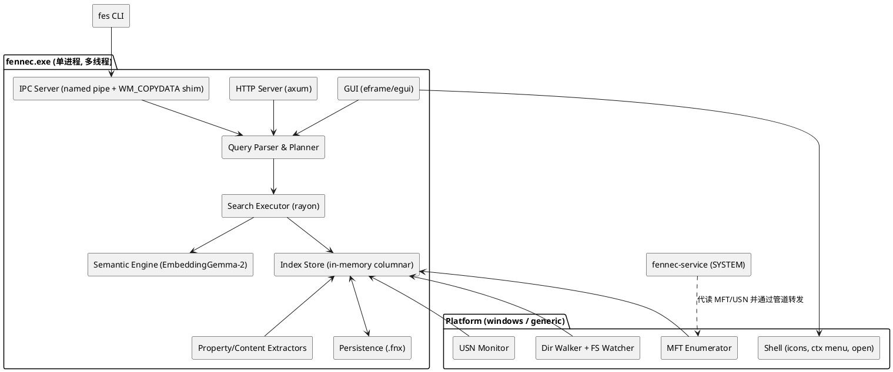
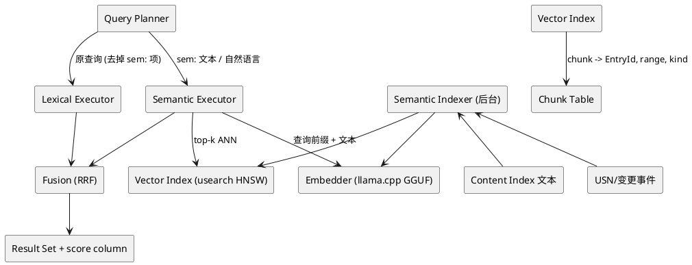

# Fennec 功能规格说明书（SPEC）

> Fennec 是一个以 voidtools Everything 1.5（Beta，截至 2026-10 最新 1.5.0.1423b）为功能基准，用 Rust + egui 从零实现的本地文件搜索引擎，并在其之上增加基于 Google EmbeddingGemma-2 的本地语义搜索能力。
>
> 读者：负责从 0 开始实现本项目的 AI 开发代理与人类评审者。本文档是"合同"，实现以本文档为准；标注 `[MUST]` 的条目为验收必需，`[SHOULD]` 为强烈建议，`[MAY]` 为可选/后续阶段。配套文件 `AGENT.md` 是开发代理的启动提示词。

---

## 目录

| 章 | 内容 |
|---|---|
| 第 0 章 总览 | 名称与品牌、产品定义、Everything 1.5 功能全景、总体架构、技术选型、全局约束、术语、版本规划 |
| 第 1 章 索引引擎 | NTFS MFT/USN、文件夹索引、文件列表、属性/内容索引、数据库格式、更新机制 |
| 第 2 章 查询语言 | 语法、运算符、通配符、修饰符、搜索函数全集、日期/大小语法、宏、筛选器 |
| 第 3 章 用户界面 | egui 主窗口、结果列表、列、排序、预览、侧栏、标签页、快捷键、选项、主题 |
| 第 4 章 系统集成 | 服务模式、命令行、fes CLI、IPC/SDK、HTTP 服务器、ETP、导入导出、右键菜单、托盘、热键 |
| 第 5 章 语义搜索 | EmbeddingGemma-2 能力分析、适用边界、混合检索架构、向量存储、运行时选型 |
| 第 6 章 实施计划 | Crate 划分、模块布局、依赖、里程碑、性能预算、测试与验收标准 |

---

# 第 0 章 总览

## 1. 名称与品牌

### 1.1 名称：Fennec（耳廓狐）

| 维度 | 说明 |
|---|---|
| 含义 | 耳廓狐是最小的狐狸，却拥有最大的耳朵——"体积最小、听见一切"，对应 Everything 的两个核心特质：极轻量、无所不索引。沙漠动物，奔跑迅捷、夜行（深色模式）、耐受恶劣环境（低资源占用）。 |
| 与 Rust 的关系 | 毛色为沙橙/锈红，与 Rust 品牌色一脉相承；Rust 社区偏好动物吉祥物。 |
| 发音/拼写 | /ˈfɛnɪk/，6 个字母，全球通用，无歧义；中文直接用 "Fennec"，副标题"耳廓狐"。 |
| 命名空间 | 产品：Fennec；主程序：`fennec.exe`；命令行查询工具：`fes.exe`（Fennec ES，对应 Everything 的 `es.exe`）；服务：`fennec-service.exe`；Rust crate 前缀：`fnc-`；SDK：`fennec-sdk` / `fennec_sdk.dll`（函数前缀 `fnc_`）；索引文件扩展名：`.fnx`；数据目录：`%APPDATA%\Fennec`；命名管道：`\\.\pipe\Fennec.<instance>.*`；互斥量：`Local\Fennec.<instance>`；URL 协议：`fennec://`；Shell 菜单文案："Search with Fennec" / "Explore in Fennec"。 |
| 口号 | "Find anything in a blink."（中文："眨眼之间，找到一切。"）|

### 1.2 图标

设计稿：`assets/icon/fennec-icon-1024.png`。实现时须以下述几何描述重绘为矢量（SVG），再导出 `.ico`（16/20/24/32/48/64/128/256）与托盘单色图。

| 要素 | 规范 |
|---|---|
| 构图 | 圆角方形底（squircle，圆角半径 22%），居中一个"耳廓狐头 = 放大镜"的组合符号：狐狸脸部为一个粗描边圆环（放大镜镜片），两只大三角耳朵从圆环顶部向上伸出，右下 45° 一段粗短手柄。 |
| 底色 | 深石板蓝渐变 `#1B2230` → `#242C3B`（深色模式友好）。 |
| 主色 | 锈橙 `#E8762B`（Rust 系色相）；描边宽度为圆环直径的 12%。 |
| 点缀 | 镜片内两点眼睛与一个小鼻子，奶油色 `#F6E7D2`。 |
| 单色变体 | 托盘/菜单用：仅主色或纯白线条，无底色，线宽加粗至 16%，去掉眼鼻。 |
| 状态变体 | 索引中：手柄末端加旋转小弧；离线/暂停：整体 60% 透明。 |
| 禁止 | 不加文字、不加投影、不使用三维材质。 |

SVG 骨架（可直接作为起点）：

```svg
<svg viewBox="0 0 256 256" xmlns="http://www.w3.org/2000/svg">
  <defs><linearGradient id="bg" x1="0" y1="0" x2="1" y2="1">
    <stop offset="0" stop-color="#1B2230"/><stop offset="1" stop-color="#242C3B"/></linearGradient></defs>
  <rect width="256" height="256" rx="56" fill="url(#bg)"/>
  <!-- ears -->
  <path d="M84 118 L70 48 L116 90 Z M172 118 L186 48 L140 90 Z" fill="#E8762B"/>
  <!-- lens / face -->
  <circle cx="128" cy="132" r="48" fill="none" stroke="#E8762B" stroke-width="14"/>
  <!-- handle -->
  <path d="M163 167 L204 208" stroke="#E8762B" stroke-width="20" stroke-linecap="round"/>
  <!-- eyes & nose -->
  <circle cx="112" cy="126" r="5" fill="#F6E7D2"/><circle cx="144" cy="126" r="5" fill="#F6E7D2"/>
  <path d="M121 146 L135 146 L128 154 Z" fill="#F6E7D2"/>
</svg>
```

---

## 2. 产品定义

### 2.1 一句话定义

Fennec 是一个常驻后台的桌面文件搜索工具：启动后数秒内为所有 NTFS 卷建立文件名索引，之后随输入即时（毫秒级）返回匹配的文件与文件夹，并通过 USN 日志实时保持索引最新。

### 2.2 核心价值（必须保留的 Everything 特质）

1. 快：索引建立以 MFT 为源而非目录遍历；搜索为内存内匹配；"边输边搜"无可感知延迟。`[MUST]`
2. 轻：100 万文件级别的索引常驻内存目标 < 150 MB，空闲 CPU ≈ 0。`[MUST]`
3. 实时：文件创建/删除/重命名/移动 1 秒内反映到结果。`[MUST]`
4. 强大的查询语言：布尔运算、通配符、正则、路径限定、按大小/日期/属性/扩展名等函数过滤，与 Everything 1.5 语法兼容。`[MUST]`
5. 键盘优先、极简 UI：一个搜索框 + 一个结果列表即可完成 90% 的工作。`[MUST]`
6. 可集成：命令行、IPC/SDK、HTTP 服务，使其他工具可复用索引。`[SHOULD]`

### 2.3 相对 Everything 的增量目标

1. 本地语义搜索（EmbeddingGemma-2）：自然语言/跨语言找文件名、文档内容、代码，可选图片。`[SHOULD]`，详见第 5 章。
2. 内存安全与可维护性：Rust 实现。
3. 跨平台可能性：平台层抽象，Windows 为一等公民，Linux/macOS 以目录遍历 + 文件系统事件作为降级后端。`[MAY]`

### 2.4 非目标（Non-goals）

- 不复刻 Everything 的二进制数据库格式或 `Everything.ini` 格式（但提供导入 1.4/1.5 的筛选器/书签/EFU 文件列表的能力）。
- 不实现 Everything 插件 DLL ABI。
- 第一版不实现 ETP/FTP 服务器（列为 `[MAY]`）。
- 不做云同步、不上传任何数据、不内置遥测。

---

## 3. 基准：Everything 1.5 功能全景

以下为对 Everything 1.5 的功能盘点，作为后续各章的来源索引。标注 ★ 的为 1.5 新增（相对 1.4）。

### 3.1 索引
- NTFS 卷：读 MFT 建索引，USN Journal 实时更新；可自动创建/配置 USN 日志（最大大小、分配增量）。
- ReFS 卷：使用 ReFS 变更日志。
- ★ FAT/exFAT/网络/任意目录的"文件夹索引"：目录遍历 + 定时重扫 + 变更通知。
- 文件列表（`.efu`）：把 CSV 文件列表（离线介质、备份）挂入索引。
- 可选索引字段：大小、修改/创建/访问日期、属性；可为名称/路径/大小/扩展名/日期建"快速排序"索引。
- ★ 属性索引：为指定目录/类型索引 Windows 属性（尺寸、时长、作者、EXIF、版本信息等 300+ 属性）。
- ★ 内容索引：为指定目录/扩展名索引文本内容（纯文本解析 + iFilter）。
- 排除：按文件夹、按文件、按通配符、隐藏/系统文件。
- ★ 索引日志（Index Journal）：记录索引的历史变更，可搜 `date-recently-changed:` / `rc:`。
- ★ 硬链接跟踪、虚拟文件夹索引、后台更新。
- 数据库持久化（`Everything.db`），启动直接加载，USN 回放补差。

### 3.2 搜索语言
- 运算符：空格 AND、`|` OR、`!` NOT、`< >` 分组、`" "` 引号。默认 OR 优先于 AND，可配置。
- 通配符：`*`（不跨 `\`）、`**`（跨 `\`）、`?`；`wildcards:` 集合语法。
- 正则（`regex:` 或全局开关）。
- 修饰符（`case:` `nocase:` `path:` `nopath:` `ww:` `wfn:` `diacritics:` `nows:` `nopunc:` `prefix:` `suffix:` `exact:` `utf8:` `binary:` `dotall:` `ascii:` `atoi:` `atof:` 等）。
- 搜索函数 200+：文件/文件夹、大小、日期、属性、父子关系、重复项、内容、音频/图片/视频/文档/可执行文件属性、哈希、文件列表、系统索引等。
- 日期语法（ISO8601、本地化、相对 `3days`、常量 `today` `lastweek` `mtd` 等）、大小常量（`tiny` `huge`）、持续时间语法。
- 列表 `;`、范围 `..`、比较 `> >= < <= = !=`、`unknown`。
- 宏（`audio:` `doc:` `exe:` `image:` `video:` `zip:` + 自定义）、字符实体（`&sp:` `&quot:`）。
- ★ 搜索重排（代价低的条件先执行）、权重排序、预处理器、子表达式、`$stem:` 等替换变量、`eval:` 公式。
- ★ 拼音搜索（全拼/首字母）。
- ★ 查重：`dupe:` `sizedupe:` `dupe:name;size` `distinct:` `unique:` `dupe-count:`。
- ★ 内容搜索 `content:` `utf8content:` `textplain:` `binary:content:`。

### 3.3 界面
- 搜索框（历史下拉、自动补全）、筛选器下拉、结果列表（详细信息/图标/缩略图视图）、状态栏。
- 列：名称、路径、大小、类型、修改/创建/访问日期、属性、扩展名、运行次数、最近运行、完整路径、★任意属性列、★自定义列（公式）。
- 排序：任意列、★自然排序、★文件夹优先/混合、多级。
- ★ 高亮匹配、★ 深色模式、★ 标签页、★ 查找栏（Findbar）、★ 文件夹侧栏、★ 书签侧栏、★ 会话、预览面板、缩略图。
- 右键菜单：完整 Shell 上下文菜单 + Everything 命令（打开路径、复制完整路径、重命名、删除、属性、添加到文件列表等）。
- ★ 高级重命名（批量、正则）、★ 撤销系统、★ 自定义工具栏、★ 自定义打开命令。
- 书签（保存搜索+筛选器+排序+热键）、筛选器管理器、搜索历史、运行历史。
- 选项对话框（常规/搜索/结果/视图/字体颜色/历史/索引/内容/属性/服务器/右键菜单/键盘/高级）。
- 全局热键（显示窗口/新窗口/切换）、托盘、随 Windows 启动、单实例。

### 3.4 集成
- 服务模式（Everything Service，以 SYSTEM 运行，供非管理员用户访问 MFT/USN）。
- 命令行（`Everything.exe -s ... -newwindow -r -case -ww -p -path -parent -reindex -exit ...`）。
- ES（`es.exe`）命令行查询，支持导出 CSV/TXT/EFU、排序、列选择。
- IPC：1.4 `WM_COPYDATA` 查询协议 / `EVERYTHING_IPC_*`；★ 1.5 SDK3（命名管道）。
- HTTP 服务器（内置网页 + `?search=&json=1` JSON API，可下载文件，Basic 认证）。
- ETP/FTP 服务器（远程 Everything 互查）。
- 资源管理器右键 "Search Everything"，`Explore in Everything`。
- 导入导出：EFU/CSV/TXT 结果导出；设置导入导出；1.4 → 1.5 迁移。
- ★ 插件（HTTP/ETP/Server 作为插件存在）、★ Everything Server（局域网集中索引）。

---

## 4. 总体架构



### 4.1 进程与线程模型 `[MUST]`

- 单主进程 `fennec.exe`：
  - UI 线程（egui 事件循环，永不阻塞 > 8 ms）。
  - 索引线程：初始 MFT 枚举、文件夹遍历、DB 加载/保存。
  - 每卷一个 USN 监视线程（或一个线程多路轮询），批量应用变更。
  - 搜索线程池（rayon）：每次查询在后台执行，支持取消（新按键到来即取消旧查询）。
  - 属性/内容/语义提取线程池：低优先级，可被暂停，受 CPU/IO 限额控制。
  - IPC / HTTP 服务线程（tokio 运行时）。
- 可选服务进程 `fennec-service.exe`（Windows 服务，SYSTEM）：仅负责打开卷句柄读取 MFT/USN，把原始记录通过命名管道流式转发给用户态主进程，使主进程不需要管理员权限。管道 DACL 仅允许交互用户与管理员。
- 单实例：命名互斥量 `Local\Fennec.<instance>`；第二次启动转为向已运行实例发送命令（显示窗口/新窗口/搜索）。

### 4.2 数据流

1. 启动 → 若存在 `.fnx` 则 mmap 加载 → 校验卷签名/USN ID → 读取 USN 从上次 `next_usn` 回放 → 若日志回绕或卷签名变化则该卷全量重建。
2. 用户输入 → 解析为 AST → 规划（条件重排、索引选择、复用上一结果集）→ 并行评估 → 结果 ID 向量 → 排序 → UI 虚拟列表渲染（只渲染可见行）。
3. USN 事件 → 变更批（合并同一文件的多次事件）→ 写锁应用到索引 → 使当前结果集"脏"→ 若当前查询存在则增量重算（只评估变更条目）。

### 4.3 并发与一致性

- 索引采用"单写多读"：`parking_lot::RwLock<IndexStore>` + 世代号（generation）。搜索持读锁快照；写入在批处理内进行，锁持有时间 < 5 ms（大批量时分片提交）。
- 结果集引用条目 ID（u32）而非指针；条目删除采用墓碑标记 + 后台压缩，保证正在显示的结果不悬空。

---

## 5. 技术选型（规范性）

| 领域 | 选型 | 说明 |
|---|---|---|
| 语言/工具链 | Rust stable（edition 2024），MSVC 目标 `x86_64-pc-windows-msvc`，`aarch64-pc-windows-msvc` | 禁止 nightly-only 特性 |
| GUI | `eframe` + `egui` + `egui_extras`（表格虚拟化）| 版本以实现时最新稳定版为准，锁定在 `Cargo.lock` |
| Win32 | `windows` crate（windows-rs）| MFT/USN/Shell/注册表/服务 |
| MFT/USN | `usn-journal-rs`（FSCTL_ENUM_USN_DATA / FSCTL_READ_USN_JOURNAL）或自研等价封装；`ntfs-reader` 作为备选用于读取 `$MFT` 原始记录获取大小/时间 | 见第 1 章 |
| 通用文件系统后端 | `walkdir`/`jwalk` + `notify` | 文件夹索引、非 Windows 平台 |
| 并行 | `rayon`，`crossbeam-channel` | 搜索与提取 |
| 异步/网络 | `tokio` + `axum`（HTTP），`interprocess` 或 `windows` 命名管道（IPC）| |
| 正则 | `regex`（默认）+ `fancy-regex`（需要回溯特性时按需启用）| 需保证线性时间默认 |
| 序列化 | `serde` + `rmp-serde`/自定义二进制（索引 DB）；`toml`（设置）| |
| 日志 | `tracing` + `tracing-appender` | |
| 哈希 | `xxhash-rust`、`sha2`、`md-5`、`crc32fast` | `dupe:` 与哈希函数 |
| 文本提取 | `pdf-extract`/`lopdf`、`zip` + `quick-xml`（Office OOXML）、`encoding_rs`、`chardetng`；Windows 下可选 IFilter COM | 内容索引 |
| 图像/媒体元数据 | `image`（尺寸）、`kamadak-exif`、`lofty`（音频标签）、`mp4parse`/`matroska` 或 Windows Property System（`IPropertyStore`）| 属性索引 |
| 语义 | `llama-cpp-2`（GGUF 推理）为主，`ort`（ONNX）为备选；向量索引 `usearch` 或 `hnsw_rs`；SIMD 余弦 `simsimd` | 见第 5 章 |
| 托盘/热键 | `tray-icon`、`global-hotkey` | |
| 打包 | `cargo-wix`（MSI）+ 便携 zip | |

---

## 6. 全局约束与规范

### 6.1 性能预算 `[MUST]`

| 指标 | 目标（1,000,000 条目、NVMe、8 核） |
|---|---|
| 初次 MFT 索引（单卷 100 万条）| ≤ 60 s（目标 ≤ 15 s）|
| DB 冷加载到可搜索 | ≤ 2 s |
| 简单子串查询 p95（无快速排序索引）| ≤ 50 ms（目标 ≤ 10 ms）|
| 键入到结果刷新（含渲染）| ≤ 1 帧（16 ms）对已缓存结果；后台查询不阻塞 UI |
| USN 变更到结果可见 | ≤ 1 s |
| 常驻内存 | ≤ 150 MB（不含属性/内容/向量）|
| 空闲 CPU | ≈ 0%（USN 轮询 ≥ 1 s 间隔或事件驱动）|
| 排序 100 万结果（按名称）| ≤ 300 ms 首次，之后 ≤ 50 ms（缓存排序键）|

### 6.2 字符串与 Unicode `[MUST]`

- 文件名内部以 UTF-16 存储（与 NTFS 一致，避免无效 UTF-16 丢失）；同时缓存一份"折叠键"（case fold + 可选去变音 + NFKD 分解）用于匹配。
- 默认不区分大小写、不区分变音符号；`ẞ`≈`ss`，`æ`≈`ae`，忽略组合字符（与 Everything 1.5 分解匹配一致）。
- 自然排序（数字按数值比较）为默认名称排序。
- 支持 CJK IME 输入（egui/winit IME 事件）与拼音匹配（`pinyin-quan:` / `pinyin-jian:`）。

### 6.3 安全 `[MUST]`

- 访问 MFT/USN 需要管理员或服务；服务只暴露只读文件系统元数据，不暴露任意文件读取。
- HTTP 服务器默认关闭，默认仅绑定 `127.0.0.1`，启用时强制设置密码（Basic 认证），对通配符/正则查询设置复杂度与超时上限以防 DoS。
- IPC 管道设置 DACL；拒绝来自低完整性进程的写操作类命令（删除/重命名）。
- 所有文件操作（删除/重命名/移动）通过 Shell API（`IFileOperation`）执行，走回收站并可撤销。

### 6.4 配置与数据目录

- 安装模式：`%APPDATA%\Fennec\{settings.toml, index.fnx, content.fnx, vectors/, logs/}`。
- 便携模式：可执行文件同目录存在 `portable` 空文件时，所有数据写入同目录 `data/`。
- 便携目录不可写（如解压到 `C:\Program Files` 下且以普通用户运行，或 ACL 拒绝写入）：启动时以探测文件检测，数据改写到 `%LOCALAPPDATA%\Fennec\portable`（多实例为其下 `instances/<name>`），状态栏常驻警告并在悬停提示中给出被拒绝的目录；不静默退出、不丢数据。程序目录本身从不被写入。（0.2.0，REL-07）
- 卸载（MSI）：删除程序文件、服务（先停止）、HKLM 右键菜单键、HKLM `Run` 值、开始菜单快捷方式与 `%ProgramData%\Fennec`（服务日志）；`%APPDATA%\Fennec` 默认保留，维护界面"删除"页勾选或 `msiexec /x … REMOVEUSERDATA=1` 时删除卸载者本人的数据（其他用户、便携数据、`-install-*` 命令行开关写入的 HKCU 项不动）。
- 多实例：`-instance <name>` 使用独立数据目录与互斥量。

### 6.5 兼容性承诺

- 搜索语法：与 Everything 1.5 文档（voidtools.com/support/everything/search_syntax 与 search_functions）兼容为目标；差异必须在第 2 章 §9 的"差异表"中列出。
- ES 命令行参数：兼容 `es.exe` 常用参数子集。
- IPC：实现 1.4 `WM_COPYDATA` `EVERYTHING_IPC_COPYDATAQUERYW`/`QUERY2W` 的只读兼容层，使 EverythingToolbar、Listary、Wox 等现有客户端可直接工作。`[SHOULD]`
- 文件列表：读写 Everything EFU 格式。

---

## 7. 术语表

| 术语 | 定义 |
|---|---|
| 条目（Entry）| 索引中的一个文件或文件夹记录 |
| FRN | NTFS File Reference Number（64 位，含序列号），卷内唯一 |
| 卷（Volume）| 一个被索引的 NTFS/ReFS 卷或文件夹索引根或文件列表根 |
| 文件夹索引 | 对非 NTFS 位置（FAT、网络、任意目录）用目录遍历建立的索引 |
| 文件列表（EFU）| CSV 格式的外部文件清单，可挂载到索引 |
| 结果集 | 一次查询输出的条目 ID 有序向量 |
| 快速排序索引 | 为某列预先计算的排序键/排列，使排序 O(1) 可用 |
| 搜索函数 | `name:value` 形式的属性过滤器 |
| 修饰符 | 改变匹配方式的前缀，如 `case:` |
| 宏 | 展开为搜索表达式的别名，如 `audio:` |
| 筛选器 | UI 中可选的一个预设搜索约束（与输入框内容 AND） |
| 书签 | 保存的"搜索 + 筛选器 + 排序"组合 |
| 语义索引 | 由嵌入模型产生的向量集合及其 ANN 结构 |

---

## 8. 版本规划摘要

| 里程碑 | 内容 | 对应章节 |
|---|---|---|
| M0 | 工程骨架、CI、平台抽象、基准测试框架 | 第 6 章 |
| M1（MVP）| MFT 索引 + USN 实时更新 + 子串/通配符搜索 + egui 结果列表 + 打开/定位 | 第 1、2（部分）、3（部分）章 |
| M2 | 完整查询语言、排序、筛选器、书签、选项、持久化 DB、托盘热键 | 第 2、3 章 |
| M3 | 文件夹索引、文件列表、属性索引、内容索引、查重、预览、缩略图 | 第 1、3 章 |
| M4 | fes CLI、IPC 兼容层、HTTP 服务器、服务模式、右键菜单集成、导入导出 | 第 4 章 |
| M5 | 语义搜索（文件名 → 内容 → 代码 → 图片）| 第 5 章 |
| M6 | 标签页、查找栏、高级重命名、撤销、本地化、安装包、跨平台后端 | 第 3、6 章 |
| 0.2.0 发布 | 不加新功能：崩溃日志、升级兼容、语义关闭释放内存、读文件列排序、24 h 稳定性测试、双包（标准/实验）、安装验证、性能回归 | 第 6 章 §3 |

详细验收标准见第 6 章。

---

# 第 1 章 索引引擎（Index Engine）

本章定义索引的数据模型、各类数据源（NTFS/ReFS、文件夹、文件列表）、持久化格式、实时更新机制、可选的属性/内容索引，以及排除规则。

---

## 1. 数据模型

### 1.1 条目（Entry）`[MUST]`

索引采用列式（SoA）布局以利缓存与并行扫描。每个条目由一个 `EntryId(u32)` 标识（卷内连续分配，删除后墓碑复用）。

| 列 | 类型 | 必有 | 说明 |
|---|---|---|---|
| `name` | UTF-16 片段（指向全局字符串池 `NameArena`，偏移 u32 + 长度 u16）| 是 | 文件/文件夹名（不含路径）|
| `name_fold` | UTF-16/UTF-8 片段 | 是 | 大小写折叠 + 去变音 + NFKD 的匹配键；与 `name` 相同时共享 |
| `parent` | `EntryId` 或 `NONE` | 是 | 父文件夹条目（卷根的 parent 为该卷的 root 条目）|
| `volume` | `VolumeId(u8/u16)` | 是 | 所属卷 |
| `flags` | u16 位集 | 是 | `IS_DIR`, `HIDDEN`, `SYSTEM`, `READONLY`, `REPARSE`, `COMPRESSED`, `ENCRYPTED`, `OFFLINE`, `TEMP`, `SPARSE`, `NOT_CONTENT_INDEXED`, `DELETED(墓碑)`, `HARDLINK_ALIAS` |
| `frn` | u64 | NTFS/ReFS | 文件引用号（用于 USN 变更定位）|
| `size` | u64 | 可选（默认开）| 文件大小；文件夹大小按需聚合（可选索引）|
| `date_modified` | i64 FILETIME | 可选（默认开）| |
| `date_created` | i64 | 可选（默认开）| |
| `date_accessed` | i64 | 可选（默认关）| |
| `attributes` | u32 | 可选（默认开）| 原始 Win32 属性 |
| `ext_id` | u16 → 扩展名字典 | 是（派生）| 由 `name` 派生，加速 `ext:` 与类型列 |
| `run_count` / `date_run` | u32 / i64 | 是 | 运行历史（Everything "Run Count"）|
| `date_recently_changed` | i64 | 是 | 索引日志：该条目在索引中最近一次变化时间（`rc:`）|

全路径不存储，由 `parent` 链即时拼接并缓存（LRU，按 EntryId）。Everything 同样以此节省内存。

### 1.2 卷（Volume）

```text
Volume {
  id: VolumeId,
  kind: Ntfs | ReFS | Folder | FileList,
  root_path: String,          // "C:\" / "\\server\share\dir" / "D:\backup.efu"
  display_name,
  volume_serial: u32, volume_guid, fs_name,
  usn_journal_id: u64, next_usn: i64,     // NTFS/ReFS
  include_in_index: bool, online: bool,
  index_options: { size, dm, dc, da, attrib, fast_sort: {name, path, size, ext, dm, dc, da} },
  rescan_policy (Folder): { interval, on_change: bool(notify), on_startup: bool }
}
```

### 1.3 内存预算

- 100 万条目：`name` 平均 24 B（UTF-16）≈ 24 MB；折叠键大多与原名共享，额外 ≈ 5 MB；固定列（parent/flags/frn/size/3 日期/attr/ext）≈ 4+2+8+8+24+4+2 = 52 B ≈ 52 MB。合计 ≈ 85 MB，预留排序键/缓存后 < 150 MB 符合 第 0 章 §5.1。
- 必须避免为每个条目分配独立 `String`。

---

## 2. NTFS 后端（Windows）`[MUST]`

### 2.1 枚举（初次建立）

1. 枚举卷：`GetLogicalDrives` + `GetVolumeInformationW`；仅 NTFS/ReFS 走本后端；记录卷序列号与 GUID 路径（`\\?\Volume{GUID}\`），以 GUID 作为持久标识（盘符可变）。
2. 打开卷句柄 `\\.\C:`（`FILE_READ_ATTRIBUTES | SYNCHRONIZE`, 共享读写）。
3. 查询/创建 USN 日志：`FSCTL_QUERY_USN_JOURNAL`；若不存在且设置允许则 `FSCTL_CREATE_USN_JOURNAL`（默认 MaximumSize 32 MB、AllocationDelta 4 MB，可配置）。记录 `UsnJournalID` 与 `NextUsn`（在枚举之前取，保证不漏事件）。
4. 枚举 MFT：`FSCTL_ENUM_USN_DATA`（`MFT_ENUM_DATA_V1`, 请求 `USN_RECORD_V3` 以获得 128 位 FRN/ReFS 兼容），缓冲区 ≥ 1 MB，循环直到 `ERROR_HANDLE_EOF`。每条记录给出：FRN、ParentFRN、FileName、FileAttributes。此阶段不含大小与时间。
5. 构建树：先把所有记录按 FRN 放入 `HashMap<frn, EntryId>`（或开放寻址表），第二遍解析 parent；根目录 FRN 为 `0x5`；父不存在的记录（孤儿）归入隐藏"$Orphans"根。
6. 大小/日期补齐（两条路径，择一或组合）：
   - 路径 A（默认）：后台线程按目录分组调用 `NtQueryDirectoryFile`/`FindFirstFileExW(FindExInfoBasic)` 批量取得大小/时间，与 Everything 的行为一致（Everything 1.5 同样在索引后补齐）。
   - 路径 B（可选、更快）：直接读取 `$MFT` 原始记录（`ntfs-reader`），解析 `$STANDARD_INFORMATION` 与 `$DATA` 属性大小，速度为路径 A 的数倍，但需处理非驻留属性与硬链接。
   - 补齐阶段 UI 可搜索，状态栏显示"正在获取文件大小 x%"。
7. 硬链接：同一 FRN 出现多个 `FILE_NAME` 时，保留每个名字为独立条目，`HARDLINK_ALIAS` 标记，`hardlink-count:` 可查。
8. 性能要求：100 万条目枚举 + 建树 ≤ 15 s（典型 2–5 s）。

### 2.2 实时更新（USN Journal）

1. 每卷线程：`FSCTL_READ_USN_JOURNAL`（`READ_USN_JOURNAL_DATA_V1`, `ReasonMask` 全部，`ReturnOnlyOnClose=0`, `Timeout=0`, `BytesToWaitFor=1` 以阻塞等待，或轮询间隔 1 s 可配置）。
2. 事件折叠：以 FRN 为键，在一个批次（≤ 100 ms 或 ≤ 4096 条）内合并：`FILE_CREATE` + `FILE_DELETE` 抵消；`RENAME_OLD_NAME`+`RENAME_NEW_NAME` 合并为 Rename；`DATA_*`/`BASIC_INFO_CHANGE` 仅在 `CLOSE` 时触发一次元数据刷新。
3. 应用变更：
   - Create：插入条目（名、parent、attr），异步补齐大小/时间。
   - Delete：墓碑标记；若为目录，递归标记其子树（子树枚举依赖 `children` 反向索引，见 §6）。
   - Rename/Move：更新 `name`、`name_fold`、`ext_id`、`parent`，失效路径缓存，更新排序索引。
   - Attr/Size/Date change：更新对应列。
4. 更新 `next_usn` 并周期性（每 N 秒或每 M 次变更）写回 DB 头部。
5. 异常处理：
   - `ERROR_JOURNAL_ENTRY_DELETED`（日志回绕）或 `UsnJournalID` 变化 → 该卷全量重建（后台，期间旧索引仍可搜索）。
   - `ERROR_JOURNAL_DELETE_IN_PROGRESS` / 卷脱机 → 卷标记 offline，保留索引，结果以灰色显示（可配置隐藏）。
   - USN rollback（1.5.0.1394 修复的场景）：若读到的 USN < 上次记录值，则按新值继续但触发一次校验扫描。
6. 卷热插拔：监听 `WM_DEVICECHANGE`/`DBT_DEVICEARRIVAL`，自动添加/下线卷。

### 2.3 ReFS

- 同样使用 `FSCTL_ENUM_USN_DATA`/`FSCTL_READ_USN_JOURNAL`（ReFS 支持 USN 日志但无 MFT）；需 `USN_RECORD_V3`（128 位 FileReferenceNumber）。
- 若 ReFS 卷未启用日志，提示并可自动启用。

### 2.4 权限与服务

- 非管理员运行时：尝试直接打开卷句柄失败 → 检查服务是否已安装/运行 → 通过命名管道 `\\.\pipe\Fennec.<instance>.svc` 请求 `EnumMft(volume)` 与 `ReadUsn(volume, from)` 流；服务端只实现这两个只读 RPC + `QueryJournal`，拒绝其他请求。
- 服务安装/卸载：`-install-service` / `-uninstall-service`（需提升）。
- 若两者均不可用，降级为"文件夹索引"模式遍历该盘并给出提示。

---

## 3. 文件夹索引（Folder Index）`[MUST]`

用于 FAT/exFAT/网络共享/云同步目录/非 Windows 平台。

1. 配置：根路径、是否包含子文件夹、重扫间隔（默认 1 h；0 = 仅手动）、是否在启动时重扫、是否使用变更通知。
2. 初次扫描：`jwalk` 并行遍历，收集名、attr、大小、时间；网络路径限制并发度为 4。
3. 变更通知：`ReadDirectoryChangesW`（`notify` crate）递归监听；网络共享可能不支持通知，此时回退定时重扫。
4. 重扫差异合并：以 (parent, name) 为键与现有条目做三路合并，保留 EntryId 稳定。
5. 结果与 NTFS 条目同样参与所有查询；`volume-kind:folder` 可过滤。

---

## 4. 文件列表（EFU）`[SHOULD]`

- 格式：CSV，UTF-8（可带 BOM），表头 `Filename,Size,Date Modified,Date Created,Attributes`；`Filename` 为完整路径，日期为 FILETIME 十进制或 ISO8601；兼容 Everything 1.4/1.5 导出。
- 用途：索引离线光盘/移动硬盘/备份快照；也用于 `filelist:` 搜索函数与 ES 导出。
- 挂载的文件列表作为 `FileList` 卷出现，路径前缀保持原样；条目标记 `OFFLINE`。
- 文件列表编辑器：可从结果中添加/删除条目并另存。

---

## 5. 持久化（`.fnx`）`[MUST]`

### 5.1 目标

- 启动 ≤ 2 s 可搜索：采用自描述、按列分段的二进制文件，`memmap2` 映射后直接使用（零拷贝）；需要可变的列在加载时拷贝。
- 原子写：写入 `index.fnx.tmp` 后 `rename`；保留上一个版本 `index.fnx.bak`。
- 校验：每段 xxh3 校验和；版本号；损坏时自动重建并保留日志。版本号可读则加载，旧版不可读/未来版本/损坏时原文件改名为 `index.fnx.v<N>.bak` / `index.fnx.corrupt.bak` 后重建并在状态栏提示（ADR-038，其他存储同样处理）。

### 5.2 布局

```text
Header { magic "FNX1", version, created, flags }
VolumeTable [ Volume... ]   // 含 usn_journal_id / next_usn / 卷 GUID
Segment NameArena (UTF-16)
Segment FoldArena
Segment Columns: parent, flags, frn, size, dm, dc, da, attr, ext_id, run_count, date_run, rc
Segment ExtDict
Segment FastSortIndexes (可选, 每列一个 u32 排列)
Segment RunHistory / SearchHistory (可选, 也可独立文件)
Footer { segment directory, checksums }
```

### 5.3 保存策略

- 退出时保存；运行中每 5 分钟（可配）后台增量快照；USN `next_usn` 写入频率更高（每 10 s）。
- 启动时按卷校验 GUID + 序列号 + `UsnJournalID`；不匹配则该卷重建。

---

## 6. 内存索引结构 `[MUST]`

| 结构 | 用途 |
|---|---|
| `children: CSR 邻接表（parent → 子条目区间）` | 删除目录子树、`child:`/`childcount:`、文件夹大小聚合、路径前缀搜索（`c:\windows\`）|
| `frn_map: HashMap<u64, EntryId>`（每卷）| USN 事件定位 |
| `ext_dict` + `ext_postings: Vec<Vec<EntryId>>` | `ext:` 快速过滤 |
| `fast_sort[col]: Vec<u32>` | 排序 O(1) 可用；增量维护用"脏标记 + 局部重排" |
| 可选 `trigram_index`（见 §6.1）| 加速长查询的子串匹配 |

### 6.1 匹配加速策略

Everything 1.5 的"输入更多字母快 100 倍"来自结果集复用：若新查询是旧查询的"收窄"（追加字符且无运算符语义变化），只在上一结果集上继续过滤。本项目 `[MUST]` 实现：

1. 结果集复用：Planner 判定新 AST 是否蕴含旧 AST（规则：对纯 AND 项的字面追加、`ext:` 等值收窄），是则输入集合 = 上一结果集。
2. 并行全扫描：`rayon` 分块（64K 条目/块）对 `name_fold` 做子串匹配（`memchr`/两路 SIMD 搜索）。100 万条、平均 24 B 名称的全扫描 ≈ 24 MB 内存带宽 → < 10 ms。
3. `[SHOULD]` 三元组倒排索引（仅在条目数 > 200 万时自动启用）用于 ≥ 3 字符的字面项预筛。
4. 条件重排：Planner 估算每个 AND 项的选择度与代价（`ext:`、`size:`、`dm:` 等列扫描最便宜；`content:`、`hash:`、`regex:` 最贵），便宜且选择性强的先执行。`content:` 等"慢函数"只在前置过滤后的候选上执行，与 Everything 的搜索重排一致。

---

## 7. 排除规则 `[MUST]`

- 排除文件夹列表（支持通配符、`;` 分隔）、排除文件列表、排除隐藏/系统文件/文件夹开关。
- 默认排除建议：`$RECYCLE.BIN`、`System Volume Information`（可见但默认不排除，与 Everything 保持一致为"全部索引"，由用户决定）。
- 排除规则改变后增量应用（不重建）。
- `[SHOULD]` `.gitignore` 规则支持（1.5 新增）：对指定根目录读取 `.gitignore` 并作为排除。

---

## 8. 属性索引（Property Index）`[SHOULD]`

Everything 1.5 允许"为指定文件夹/类型索引任意 Windows 属性"，以便即时搜索/排序/显示 `width:`、`duration:`、`artist:` 等。

1. 配置项：属性名、包含的文件夹（`;` 分隔，支持通配）、包含的扩展名、是否"快速排序"。
2. 提取器（按优先级）：
   - 纯 Rust 解析器：`image`（宽高）、`kamadak-exif`（拍摄日期/相机）、`lofty`（音频标签/时长/比特率）、`mp4parse`/`matroska`（视频时长/帧率/分辨率）、PE 头（版本信息/架构）、OOXML `docProps/core.xml`（标题/作者/页数）、PDF `/Info`。
   - Windows Property System（`IPropertyStore` / `SHGetPropertyStoreFromParsingName`）作为兜底，获取任意 `System.*` 属性。
3. 存储：按属性名建稀疏列（`HashMap<EntryId, Value>` 或排序数组），类型为 `Int(i64) | Float(f64) | Text | Date | MultiText`；未索引时值为 `unknown`。
4. 查询：已索引 → O(n) 列扫描；未索引且用户使用 `notindexed:prop:` 或配置允许 → 对候选集按需提取（慢查询，带进度与取消）。
5. 更新：USN `CLOSE` 事件触发对应条目重提取（防抖 2 s）；提取线程低优先级（`THREAD_MODE_BACKGROUND_BEGIN`）。

属性名 → 搜索函数/列名映射见 第 2 章 附录 B（约 300 个 Everything 1.5 属性名，实现时需全部注册，提取器可按阶段覆盖）。

---

## 9. 内容索引（Content Index）`[SHOULD]`

1. 配置：包含文件夹、包含扩展名（默认 `txt;md;ini;log;json;xml;csv;html;htm;js;ts;py;rs;java;c;cpp;h;cs;go;toml;yaml;yml`，Office/PDF 需启用解析器）、单文件大小上限（默认 4 MB）、总内容大小上限、CPU/IO 限额。
2. 提取：
   - 纯文本：`chardetng` 检测编码 → UTF-8；
   - OOXML（docx/xlsx/pptx）：解压后抽取 `word/document.xml` 等文本节点；
   - PDF：`pdf-extract`（无 OCR）；
   - Windows 可选：IFilter（`LoadIFilter` COM，建议隔离进程，对应 1.5 的 `content_ifilter_separate_process`）。
3. 存储：`content.fnx`，每条目一段压缩文本（`zstd`，字典训练）+ 可选倒排词项索引（`tantivy` 风格的简化版：词 → 条目位图）。无倒排时 `content:` 为"候选集 + 解压后子串/正则匹配"的慢查询，有倒排时词项查询可即时。
4. 搜索函数：`content:`（已索引文本，若未索引则按需读取并解析）、`utf8content:`/`ansicontent:`/`utf16content:`（原始字节按编码解释）、`textplain:`（纯文本解析器，不走 IFilter）、`binary:content:`（字节流）。
5. 更新：USN 数据变更 `CLOSE` 后重提取（防抖）。
6. 结果：`content:` 命中时记录首个命中偏移，供预览面板高亮与"命中片段"列。

---

## 10. 索引日志（Index Journal）`[SHOULD]`

- 记录 `(timestamp, action: Create|Delete|Rename|Move|Modify, path_before, path_after, volume)`，循环文件，默认保留 7 天/最多 100 万条。
- 用途：`rc:`/`date-recently-changed:` 搜索；"最近更改"视图；撤销系统参考。

---

## 11. 查重（Duplicates）`[SHOULD]`

- `dupe:` 默认按名称；`dupe:size`、`dupe:name;size`、`dupe:size;sha256`（仅对同大小候选计算哈希，哈希结果缓存到属性列）。
- `sizedupe:`、`namepartdupe:`、`attribdupe:`、`dadupe:`/`dcdupe:`/`dmdupe:`。
- `distinct:<prop>` 保留每组一条；`unique:<prop>` 仅保留无重复项；`dupe-count:`、`dupe-max:`。
- 1.5 语义：查重在"当前结果集"内进行（排序混合之后应用），与 1.4 的全索引比较不同；需在差异表中说明。

---

## 12. 跨平台后端 `[MAY]`

- Linux：`fanotify`/`inotify` + 遍历；可选读取 ext4 的 `debugfs`（不推荐）。macOS：FSEvents + 遍历；Spotlight 元数据可选。
- 平台抽象 trait：

```rust
pub trait VolumeSource: Send {
    fn enumerate(&mut self, sink: &mut dyn EntrySink) -> Result<()>;
    fn watch(&mut self, sink: &mut dyn ChangeSink) -> Result<()>;   // 阻塞或回调
    fn fetch_metadata(&self, ids: &[EntryId], out: &mut dyn MetaSink) -> Result<()>;
}
```

---

## 13. 验收用例（节选）

| 编号 | 场景 | 期望 |
|---|---|---|
| IDX-01 | 全新安装，C: 为 NTFS 100 万条目 | 60 s 内可搜索；状态栏显示进度 |
| IDX-02 | 新建 `C:\t\a.txt` | 1 s 内搜 `a.txt` 可见 |
| IDX-03 | 重命名目录 `C:\t` → `C:\u`，含 10 万子项 | 2 s 内 `u\` 前缀结果正确，路径列更新 |
| IDX-04 | 退出重启 | 2 s 内可搜索，重启期间的 100 次变更被回放 |
| IDX-05 | 删除 USN 日志后重启 | 该卷自动重建，其他卷不受影响 |
| IDX-06 | 添加 FAT32 U 盘为文件夹索引 | 遍历完成后可搜索，拔出后标记 offline |
| IDX-07 | 添加 EFU | 条目可搜索、显示离线图标 |
| IDX-08 | 启用 `width/height` 属性索引于 `D:\Photos` | `width:>4000` 即时返回 |
| IDX-09 | 启用内容索引于 `D:\Notes` | `content:"quarterly plan"` < 200 ms |
| IDX-10 | 非管理员 + 服务 | 可正常索引 NTFS |

---

# 第 2 章 查询语言（Query Language）

目标：与 Everything 1.5 搜索语法兼容（以 voidtools 官方 Search Syntax / Search Modifiers / Search Functions 文档为准），并以明确的文法、求值语义和函数目录使 AI 可以直接实现解析器与执行器。

---

## 1. 词法与文法

### 1.1 词法 `[MUST]`

- 输入为 Unicode 字符串。按以下规则切分：
  - 空白（ASCII 空格、Tab、全角空格）分隔搜索项，表示 AND。
  - `|` 为 OR；两侧空白忽略。
  - `!` 紧贴项前为 NOT；`!` 单独出现等同其后项的 NOT。
  - `<` `>` 为分组；`<` 与 `>` 必须配对，未闭合的 `>` 自动闭合（容错，与 Everything 一致）。
  - `"..."` 引号内为字面文本（运算符失效，空格保留）；`""` 为空字符串；引号内 `""` 表示字面引号。
  - 搜索项形如 `[!][mod:]*[func:]value`。`:` 之前的标识符若匹配已注册修饰符/函数/宏，则按其处理，否则整个项为字面文本（例如 `12:30` 为字面）。
  - 函数名中的 `-` 可省略（`date-modified` ≡ `datemodified`）；大小写不敏感。
  - `func*:value`：函数名后 `*` 表示其后整段到项结束为纯文本（不再解析运算符）。
  - `::name:` 强制使用内建名称，绕过用户同名宏。
  - `?mod:` 使修饰符对其后整段搜索生效（全局修饰符）。
  - 字符实体：`&sp:` 空格、`&vert:` `|`、`&excl:` `!`、`&lt:` `<`、`&gt:` `>`、`&quot:` `"`、`&amp:` `&`、`&colon:` `:`、`&percent:` `%`、`&#NNN:` 十进制、`&#xHH:` 十六进制。
  - 环境变量 `%NAME%` 在解析前展开（引号内也展开）；`&percent:` 得到字面 `%`。

### 1.2 文法（EBNF）

```ebnf
query      = or_expr ;
or_expr    = and_expr { "|" and_expr } ;             (* 默认 OR 优先级高于 AND *)
and_expr   = term { WS term } ;
term       = [ "!" ] primary ;
primary    = "<" query ">" | item ;
item       = { modifier ":" } [ function ":" ] value ;
value      = quoted | unquoted ;                      (* 允许混合: abc"def ghi"jkl *)
```

注意：Everything 默认 `apple banana | orange` = `apple AND (banana OR orange)`，即 OR 优先；选项 `operator_precedence` 可切换为 AND 优先；`?and-precedence:` / `?or-precedence:` 可在查询内切换。本项目 `[MUST]` 两种都支持，默认 OR 优先。

### 1.3 AST

```rust
enum Expr {
    And(Vec<Expr>), Or(Vec<Expr>), Not(Box<Expr>),
    Term { mods: ModSet, func: Option<FuncId>, value: Value, raw: Range<usize> },
}
enum Value { Text(String), List(Vec<Value>) /* ; */, Range(Box<Value>, Box<Value>), Cmp(CmpOp, Box<Value>), Empty, Unknown }
```

解析器必须保留原始片段范围 `raw`，供搜索框语法高亮、错误提示与"插入函数"UI 使用。

---

## 2. 字面项匹配语义 `[MUST]`

无函数的项按以下规则匹配文件名（或 Match Path 时匹配完整路径）：

1. 默认：不区分大小写、不区分变音、子串匹配（任意位置）。
2. 含通配符（`*` `?`）时切换为"全名匹配"：`*.mp3` 匹配整个名字；`foo*` 以 foo 开头。`*` 不匹配 `\`，`**` 匹配任意（含 `\`）；选项 `wildcards_star_all` 使 `*` 匹配 `\`。
3. 含 `\` 的项自动视为路径匹配（等价加 `path:`）：`c:\windows\*` 匹配该目录直接子项；`windows\*` 匹配任意名为 windows 的目录下直接子项；单个 `\` 等价 `folder:`（快速只搜文件夹）。
4. `^` 开头匹配名称开头，`$` 结尾匹配名称结尾（1.5 新增；在 `regex:` 之外也有效）。
5. 修饰符覆盖默认（见 §3）。
6. 匹配对象：`name`（默认）；开启 Match Path 或 `path:` 时为完整路径；`wfn:` 为整个文件名；`ww:` 为整词。
7. 空查询匹配全部条目。
8. 搜索延迟默认 0 ms（选项 `search_delay`）。

---

## 3. 搜索修饰符（Search Modifiers）`[MUST]`

修饰符可叠加，自右向左应用；`no-` 前缀取反；`?` 前缀全局生效。全部内建修饰符：

| 修饰符 | 别名 | 作用 |
|---|---|---|
| `case:` / `nocase:` | | 区分大小写 |
| `diacritics:` / `nodiacritics:` | `diac:` | 区分变音符号（关闭时启用 NFKD 分解匹配）|
| `path:` / `nopath:` | | 匹配完整路径 |
| `wholeword:` / `nowholeword:` | `ww:` | 整词匹配（词边界为非字母数字）|
| `wholefilename:` / `nowholefilename:` | `wfn:` `exact:` | 整个文件名/值精确匹配 |
| `wholepath:` | `wp:` | 整个完整路径匹配 |
| `regex:` / `noregex:` | | 正则（Rust `regex` 语法；需要前瞻/回溯时自动回退 `fancy-regex`）|
| `wildcards:` / `nowildcards:` | | 启用集合语法 `[a-c]` 等（默认通配符仅 `*` `?`）|
| `wildcardsstarall:` | | `*` 匹配 `\` |
| `prefix:` / `noprefix:` | | 仅匹配词首 |
| `suffix:` / `nosuffix:` | | 仅匹配词尾 |
| `startwith:` / `endwith:` | `sw:` `ew:` | 名称以…开头/结尾 |
| `ignorepunctuation:` / `nopunc:` | `punc:` | 忽略标点（`spiderman` 匹配 `spider-man`）|
| `ignorewhitespace:` / `nows:` | `ws:` | 忽略空白 |
| `utf8:` `ansi:` `utf16:` `utf16be:` | | 内容字节解释编码 |
| `binary:` / `nobinary:` | `bytestream:` | 字节流匹配，`\xNN` 转义 |
| `ascii:` / `noascii:` | | 仅 ASCII 比较（忽略非 ASCII 等价）|
| `dotall:` / `nodotall:` | | 正则 `.` 匹配换行 |
| `multiline:` | | 正则多行模式 |
| `atoi:` / `tointeger:` | `toint:` | 将属性文本作为整数比较 |
| `atof:` / `tonumber:` | `#:` | 作为实数比较 |
| `allstrings:` / `anystrings:` | | 多值属性全部/任一匹配 |
| `andfilter:` / `orfilter:` | | 多筛选器组合方式 |
| `andprecedence:` / `orprecedence:` | | 运算符优先级 |
| `fileonly:` `folderonly:` | | 限制项类型 |
| `highlight:` / `nohighlight:` | | 是否参与结果高亮 |
| `len:` | | 对值长度比较：`len:>20`、`len:album:>20` |
| `count:` | | 多值个数 |
| `notindexed:` | | 强制对未索引属性按需读取 |
| `pinyin:` `pinyinquan:` `pinyinjian:` | `py:` | 拼音全拼/首字母匹配（中文名）|
| `fuzzy:` `[MAY]` | | 编辑距离 ≤ 1 的模糊匹配（Everything 无；为本项目扩展，默认关）|

---

## 4. 值语法 `[MUST]`

### 4.1 比较与范围

`func:value`（相等或包含，取决于函数类型）、`func:>v` `>=v` `<v` `<=v` `=v` `!=v`、`func:!v`（按粒度不等）、`func:a..b` / `func:a-b` 闭区间、`func:` 空值 = 非零/非空、`func:unknown` 未知。

### 4.2 列表

`;` 分隔为 OR 列表：`ext:jpg;png;gif`、`width:1920;3840`、`dm:today;yesterday`。引号可转义 `;`。

### 4.3 大小

单位：`b kb mb gb tb pb`（1024 进制；选项可切 1000）、`k m g t`；常量：`empty`(0) `tiny`(0–10 KB) `small`(10–100 KB) `medium`(100 KB–1 MB) `large`(1–16 MB) `huge`(16–128 MB) `gigantic`(>128 MB)。`size:10mb` 的"粒度"语义：`size:1kb` 匹配 1024–2047 字节。

### 4.4 日期/时间

| 形式 | 示例 |
|---|---|
| 年 | `2026` |
| 月/年 或 年/月（按区域设置）| `07/2026` `2026/07` |
| 完整日期（区域/ISO）| `02/07/2026` `2026-07-02` `20260702` `260702` |
| ISO8601 扩展 + 时间 | `2026-07-02T10:52:00` |
| 通配 | `*-02`（任意年 2 月）、`*-*-*T9:00..*-*-*T17:00` |
| 相对 | `3days` `2weeks` `6months` `1year` `4hours` `30mins` `10secs`（表示"过去 N 内"）|
| 常量 | `today` `yesterday` `tomorrow` `thisweek` `lastweek` `nextweek` `thismonth` `lastmonth` `thisyear` `lastyear` `pastNdays`、月名/缩写、星期名/缩写、`mtd` `ytd` `qtd`、`unknown` |
| 原始 | FILETIME 十进制、Excel 序列日 |

比较语义：粒度匹配——`dm:2026` 匹配整年，`dm:2026-07` 匹配整月；范围 `dm:2026-01-01..2026-03-31`。

### 4.5 持续时间

`length:`/`duration:` 接受 `hh:mm:ss`、`mm:ss`、`90s` `5min` `2h` `1.5hours`；粒度语义同大小（`length:1min` 匹配 60–119 s）。

### 4.6 属性字母（`attrib:`）

`R` 只读 `H` 隐藏 `S` 系统 `D` 目录 `A` 存档 `V` 设备 `N` 普通 `T` 临时 `P` 稀疏 `L` 重解析点 `C` 压缩 `O` 脱机 `I` 非内容索引 `E` 加密 `U` 未修剪(1.5)。多个字母 AND：`attrib:hs`；`exact:attrib:h` 精确等于。

---

## 5. 搜索函数目录

格式：函数名（别名）— 值类型 — 语义 — 所需索引。类型：`T` 文本 `N` 数值 `D` 日期 `S` 大小 `L` 时长 `B` 布尔(无值) `P` 属性字母。“索引”列：`core` 基础索引即时；`prop` 需属性索引否则按需读取（慢）；`content` 需内容索引否则按需读取；`fs` 需访问文件系统（慢）。

### 5.1 文件与文件夹 `[MUST]`

| 函数 | 类型 | 语义 | 索引 |
|---|---|---|---|
| `file:` | B/T | 仅文件（可带名匹配）| core |
| `folder:` | B/T | 仅文件夹 | core |
| `name:` | T | 匹配名称 | core |
| `stem:` (`nameext-stripped`) | T | 不含扩展名的名称 | core |
| `ext:` (`extension:`) | T 列表 | 扩展名精确（无点）；`ext:` 空匹配无扩展名 | core |
| `path:` (`infolder:` 与 `parent:` 不同) | T | 完整路径子串 | core |
| `pathpart:` | T | 仅路径部分（不含名）| core |
| `fullpath:` `fp:` | T | 完整路径 | core |
| `parent:` `infolder:` `nosubfolders:` | T | 直接位于指定文件夹 | core |
| `parents:` `ancestors:`/`ancestor:` | T | 任意祖先为指定文件夹 | core |
| `parent+N:` / `ancestor-sibling:` / `parent-sibling:` | T | 第 N 级父 / 祖先同级 / 父同级 | core |
| `child:` | T | 文件夹含有匹配的直接子项（支持通配）| core |
| `childcount:` `childfilecount:` `childfoldercount:` | N | 直接子项数 | core |
| `descendant:` `descendantcount:` 等 | T/N | 任意深度子项 | core |
| `depth:` `parents-count:` | N | 路径深度（根为 0）| core |
| `empty:` | B | 空文件夹（无子项）或 0 字节文件 | core |
| `root:` | B | 卷根 | core |
| `len:` `namelength:` `pathlength:` `fullpathlength:` | N | 长度 | core |
| `size:` | S | 文件大小；文件夹大小需 `folder-size` 索引 | core |
| `folder-size:` `fs:` `[SHOULD]` | S | 聚合文件夹大小 | core(聚合) |
| `dm:` `datemodified:` | D | 修改日期 | core |
| `dc:` `datecreated:` | D | 创建日期 | core |
| `da:` `dateaccessed:` | D | 访问日期 | core(可选) |
| `dr:` `daterun:` | D | 最近运行 | core |
| `rc:` `daterecentlychanged:` | D | 索引日志最近变化 | core |
| `runcount:` | N | 运行次数 | core |
| `attrib:` `attributes:` `a:` | P | 属性 | core |
| `type:` | T | 类型描述（如 "Text Document"），来自注册表 | core(派生) |
| `kind:` | T | 分类：`audio video image document executable archive folder shortcut` 等 | core(派生) |
| `volume:` `drive:` | T | 卷/盘符 | core |
| `volume-kind:` | T | `ntfs refs folder filelist` | core |
| `online:` `offline:` | B | 卷在线状态 | core |
| `case:`… | | 见修饰符 | |
| `fsi:` `filesignature:` `[MAY]` | T | 文件签名（魔数）类型 | fs |
| `hardlinkcount:` `hardlinks:` | N | 硬链接数 | core/fs |
| `reparse:` `reparsetag:` `symlink:` `junction:` | B/T | 重解析点 | core |
| `target:` `linktarget:` `shortcuttarget:` | T | 链接/快捷方式目标 | fs |
| `recycled:` `recyclebinoriginalpath:` `[MAY]` | B/T | 回收站项 | fs |
| `frn:` `index-frn:` | N | 文件引用号 | core |
| `nameparts:` `[MAY]` | N | 名称词数 | core |
| `startwith:` `endwith:` | T | 名称开头/结尾 | core |
| `nameextstripped`… 其余别名 | | 注册为别名表 | |

### 5.2 组合与集合函数 `[MUST]`

| 函数 | 语义 |
|---|---|
| `dupe:[props]` `sizedupe:` `namepartdupe:` `attribdupe:` `dadupe:` `dcdupe:` `dmdupe:` | 结果集内重复项（见 第 1 章 §11）|
| `distinct:prop` `unique:prop` `dupe-count:N` `dupe-max:N` | 去重/唯一/重复数 |
| `filelist:"a";"b"` `filelistfilename:` | 显式路径列表 / 来自文件 |
| `fileexists:path` `folderexists:` | 存在性（支持 `$stem:` 等替换，相对当前条目目录）|
| `sibling:name` `siblingcount:` `[SHOULD]` | 同目录兄弟 |
| `random:` `[MAY]` | 随机抽样 N |
| `omit:` | 临时忽略（UI “Omit result”）|
| `si:` `system-index:` `[MAY]` | 转发 Windows Search 系统索引（AQS 查询，见 §9）|
| `eval:expr` `[SHOULD]` | 公式求值（Excel 风格函数子集：`LEN SUM IF AND OR SWITCH ISNUMBER…`，变量 `$size:` `$name:` 等）|
| `weight:N` `[SHOULD]` | 为项设置排序权重（Everything 搜索权重）|
| `add-prefix:` `add-suffix:` 等预处理器 `[MAY]` | 搜索预处理 |

替换变量（可用于支持的函数的值中）：`$stem:` `$name:` `$ext:` `$path:` `$parent:` `$fullpath:` `$size:` `$dm:` 等，表示"当前候选条目"的对应属性。

### 5.3 内容函数 `[SHOULD]`

`content:` `utf8content:` `ansicontent:` `utf16content:` `utf16becontent:` `textplain:` `binary:content:` `contenthits:`（命中次数 N）`line-count:` `word-count:` `char-count:` `[MAY]`。详见 第 1 章 §9。

### 5.4 哈希/校验 `[SHOULD]`（`fs`，带缓存）

`crc32:` `crc64:` `md5:` `sha1:` `sha256:` `sha512:` `ed2k:` `[MAY]`；值为十六进制；`hash:unknown` 未计算。

### 5.5 图像 `[SHOULD]`（`prop`）

`width:` `height:` `dimensions:`(`1920x1080`) `aspect-ratio:`(`16:9` / `portrait` / `landscape` / `square`) `bit-depth:` `horizontal-resolution:` `vertical-resolution:` `orientation:` `date-taken:` `camera-maker:` `camera-model:` `exposure-time:` `f-stop:` `iso-speed:` `focal-length:` `flash:` `latitude:` `longitude:` `altitude:` `people:` `tags:`(`keywords:`) `rating:` `title:` `subject:` `comment:` `copyright:`。

### 5.6 音频 `[SHOULD]`（`prop`）

`length:`(`duration:`) `artist:` `album:` `album-artist:` `title:` `track:`(`track-number:`) `disc:` `genre:` `year:` `composer:` `conductor:` `publisher:` `bit-rate:` `sample-rate:` `channels:` `bits-per-sample:` `encoding-bitrate:` `is-variable-bit-rate:` `lyrics:` `mood:` `bpm:` `initial-key:` `encoded-by:` `comment:` `rating:`。

### 5.7 视频 `[SHOULD]`（`prop`）

`frame-width:` `frame-height:` `frame-rate:` `fps:` `video-bitrate:` `total-bitrate:` `compression:` `video-codec:` `audio-codec:` `date-encoded:` `director:` `producer:` `writer:` `stream-count:` `four-cc:` `data-rate:`。

### 5.8 文档 `[SHOULD]`（`prop`）

`title:` `subject:` `author:`(`authors:`) `last-author:` `category:` `keywords:` `comments:` `company:` `manager:` `page-count:` `slide-count:` `word-count:` `char-count:` `line-count:` `paragraph-count:` `revision-number:` `template:` `date-printed:` `date-last-saved:` `content-created:` `total-editing-time:` `security:`。

### 5.9 可执行文件 `[SHOULD]`（`prop`）

`file-version:` `product-version:` `product-name:` `company:`(`company-name:`) `file-description:` `original-filename:` `internal-name:` `legal-copyright:` `legal-trademarks:` `private-build:` `special-build:` `language:` `machine:`(`x86` `x64` `arm64`) `subsystem:` `is-dll:` `is-signed:` `[MAY]` `linker-version:` `os-version:` `image-version:`.

### 5.10 压缩包/容器 `[MAY]`

`container-filenames:`(`zipfilenames:`) `container-file-count:` `container-size:`，支持 zip/7z/rar(列表)。

### 5.11 其他 `[MAY]`

`shell-attributes:` `sfgao:` `thumbnail:` `icon:` `index-source:` `index-journal-id:` `date-indexed:` `date-usn:` `usn:` `ctime`(`date-changed:` NTFS 变更时间)、`owner:`(`fs`)、`object-id:`、`alternate-data-streams:`(`ads:` `adscount:`)、`cluster-size:` `allocation-size:`(`size-on-disk:`)。

---

## 6. 宏（Macros）`[MUST]`

内建：

| 宏 | 展开（默认扩展名列表，可在筛选器管理器中编辑）|
|---|---|
| `audio:` | `ext:aac;ac3;aif;aifc;aiff;au;cda;dts;fla;flac;it;m1a;m2a;m3u;m4a;mid;midi;mka;mod;mp2;mp3;mpa;ogg;opus;ra;rmi;spc;rmi;snd;umx;voc;wav;wma;xm` |
| `zip:` | `ext:7z;ace;arj;bz2;cab;gz;gzip;jar;r00;r01;…;r29;rar;tar;tgz;z;zip;zst;xz;lz;lzma;iso;img;dmg` |
| `doc:` | `ext:c;chm;cpp;csv;cxx;doc;docm;docx;dot;dotm;dotx;h;hpp;htm;html;hxx;ini;java;lua;mht;mhtml;odt;pdf;potx;potm;ppam;ppsm;ppsx;pps;ppt;pptm;pptx;rtf;sldm;sldx;thmx;txt;vsd;wpd;wps;wri;xlam;xls;xlsb;xlsm;xlsx;xltm;xltx;xml;md;rs;py;ts;js;go;json;toml;yaml;yml` |
| `exe:` | `ext:bat;cmd;exe;msi;msp;scr;com;ps1;vbs` |
| `image:` `pic:` | `ext:ani;bmp;gif;ico;jpe;jpeg;jpg;pcx;png;psd;tga;tif;tiff;webp;heic;heif;avif;svg;raw;cr2;nef;arw;dng` |
| `video:` | `ext:3g2;3gp;3gp2;3gpp;amr;amv;asf;avi;bdmv;bik;d2v;divx;drc;dsa;dsm;dss;dsv;evo;f4v;flc;fli;flic;flv;hdmov;ifo;ivf;m1v;m2p;m2t;m2ts;m2v;m4b;m4p;m4v;mkv;mp2v;mp4;mp4v;mpe;mpeg;mpg;mpls;mpv2;mpv4;mov;mts;ogm;ogv;pss;pva;qt;ram;ratdvd;rm;rmm;rmvb;roq;rpm;smil;smk;swf;tp;tpr;ts;vob;vp6;webm;wm;wmp;wmv` |

自定义宏：筛选器可定义"宏名"，使 `name:` 展开为该筛选器的搜索；支持参数 `#param:`（如 `::pinyin:#param:`）。宏展开在解析阶段完成且防止递归（深度 ≤ 8）。

---

## 7. 筛选器（Filters）与书签 `[MUST]`

- 筛选器 = `{ name, search, macro, case, ww, path, regex, diacritics, key }`；UI 下拉选择一个（或多选，组合方式由 `and-filter:`/`or-filter:` 决定）；生效时等价 `<filter.search> <用户输入>`。
- 内建筛选器：Everything（空）、Audio、Compressed、Document、Executable、Folder、Picture、Video。
- 书签 = `{ name, search, filter, sort, sort_dir, view, key, folder(分组) }`，触发时替换当前搜索与排序。
- 导入 Everything 1.4/1.5 `Filters.csv` / `Bookmarks.csv`（兼容其导出格式）。

---

## 8. 执行语义与规划 `[MUST]`

1. 规范化：宏展开 → 环境变量 → 实体 → AST → 修饰符折叠 → 常量折叠（空 OR、重复项）。
2. 代价模型：每个 Term 标注 `(cost, selectivity_estimate)`：
   - `ext:`/`folder:`/`file:`/`attrib:` = 最低（位图/字典）；
   - `size:`/`dm:`/`dc:`：列扫描；
   - 字面名匹配：列扫描 + 字符串搜索；
   - `regex:`：中；
   - `path:` 字面：需拼路径（使用 `children` 与前缀树优化：若字面以 `X:\` 开头，直接定位子树）；
   - `prop`（已索引）：稀疏列；未索引：高（按需读）；`content:`：最高；`hash:`：最高。
3. AND 内按代价升序执行；OR 内并行执行再并集；NOT 在候选集合上做差。
4. 结果集复用：见 第 1 章 §6.1。
5. 取消：所有扫描按块检查 `CancellationToken`；UI 每次按键取消旧查询。
6. 慢查询保护：预计耗时 > 300 ms 时状态栏显示进度与"取消"；`content:`/`hash:` 等在未经前置过滤时弹出一次性提示（Everything "Slow queries" 行为），可关闭。
7. 高亮：执行器为每个命中条目返回匹配区间（名称/路径各一组），供 UI 高亮；`nohighlight:` 项不参与。
8. 错误：未知函数名 → 作为字面文本；未闭合引号 → 到行尾；非法正则 → 该项匹配空并在状态栏提示。

---

## 9. 与 Everything 的已知差异（实现时维护）

| 项 | Everything 1.5 | 本项目 | 原因 |
|---|---|---|---|
| 正则引擎 | PCRE 风格 | Rust `regex`，回溯特性回退 `fancy-regex` | 线性时间安全 |
| `si:` `system-index:` 系统索引 | 用 AQS 查询 Windows Search 系统索引 | 已实现：值原样作为 AQS（`si:"my content"` 去掉引号；`si*:"a phrase"` 保留引号成短语，`&quot:` 得字面引号；`;` 视为文本），经 `ISearchQueryHelper`（`SystemIndex` 目录）生成 SQL，由 `Search.CollatorDSO` OLE DB 执行，取 `SCOPE='file:'` 项的 `System.ItemPathDisplay`，再在**本索引**中解析为条目（不在索引中的路径忽略）；每次搜索编译时只查询一次，相同文本 30 s 内跨搜索复用；最多 100 000 项（超出时提示）、20 s 超时、可取消；按运行 Fennec 的用户做安全过滤；空值 = 系统索引中的全部项；服务未安装/未运行或非 Windows 时不匹配并在状态栏提示 | 依赖 Windows Search 服务；结果受其索引范围与延迟影响；AQS 属性关键字随 Windows 显示语言（中文系统为 `种类:文档` `文件名:`，规范名 `System.FileName:` 通用）|
| 插件/预处理器 | DLL 插件 | 不实现 DLL ABI | 安全/范围 |
| `fuzzy:` | 无 | 扩展，默认关 | 本项目增强 |
| `semantic:` / `sem:` | 无 | 新增（见第 5 章）| 语义搜索 |
| 名称排序的非数字部分 | `CompareStringEx`（区域排序规则，如 zh-CN 拼音序）| 设置 `name_collation`：`auto`（默认；中文界面按拼音，否则按码点）/ `pinyin` / `codepoint`；拼音序下汉字按首个读音（不带声调）再按码点比较，拉丁字母与数字排在汉字前，数字按数值；排序名次列记录所用规则，规则变化时重建 | 只实现拼音，不依赖 OS 区域 |
| `%VAR%` 展开结果 | 展开后再解析（运算符生效）| 展开结果视为字面文本 | 防止环境变量内容意外改变查询结构 |
| 日期字段顺序 / 每周首日 | 跟随系统区域 | 设置 `date_input_order`、`week_start` 默认 `auto`：Windows 取 `GetLocaleInfoEx(LOCALE_SSHORTDATE / LOCALE_IFIRSTDAYOFWEEK)`，其他平台按 `LC_TIME`/`LANG` 推断；可改为固定值 | — |
| `ext:` 与文件夹 | — | 文件夹无扩展名，`ext:` 永不匹配文件夹 | 与资源管理器"类型"一致 |
| `junction:` / `symlink:` | 依据重解析标记 | 重解析标记未入索引（USN 枚举不提供）：文件夹重解析点视为 junction、文件视为 symlink；带云占位/去重属性（offline、sparse、recall-on-open/data-access、pinned/unpinned）的重解析点不算链接，`target:` 也不读取它们（`attr::is_link_reparse`）| 取标记需逐个打开文件 |
| NTFS 硬链接 | 每个文件名一个条目 | 每个名称一个条目：MFT 枚举得到一个名称，其余名称由大小/日期补齐阶段的目录列举（带文件 ID）补全；`HARD_LINK_CHANGE` 记录不区分添加与删除：新名称按别名加入，批次末尾再检查磁盘上该名称是否仍存在，不存在则只删除这个名称（主名称被删时文件号交给其余别名）| `FSCTL_ENUM_USN_DATA` 每个文件只返回一个名称（ADR-010）|
| ReFS 128 位文件 ID | 原样 | 折叠为 64 位（零扩展保持原值，否则 xxh3）| 索引 FRN 列为 u64 |
| `.fnx` 加载 | — | 整文件读入后解码（不 mmap），全部列本就可变需拷贝 | ADR-012 |
| 服务每连接鉴权 | 会话 ID 校验 | 管道 DACL 仅允许 SYSTEM/管理员/交互用户；另在接受连接时按客户端 PID 校验：必须处于交互会话（会话 ≠ 0，排除其他服务）且完整性 ≥ Medium（排除低完整性沙箱进程），否则立即断开 | 服务在会话 0，无法要求"同会话"（ADR-011）|
| "类型"列排序 | 按类型描述 | 按类型描述排序（`SortColumn::Type`）：描述来自 `SearchOptions::type_names` 提供者（每个扩展名查一次并缓存），无提供者或无结果时 "`EXT` File"，文件夹 "File folder"、无扩展名 "File"；描述折叠后按自然序，同描述按名称；文件夹分组规则不变（`FoldersFirst::Never` 时 "File folder" 与其他描述一起排序）| — |
| 自定义列排序 | 可排序 | 列头单击按公式值排序（`SortKey::Custom` / `SortSpec::custom`，公式来自 `SearchOptions::formulas`，与 `custom_columns` 设置一致）：每个结果并行求值，数值按数值、日期按时间、文本按自然序（折叠），类型混合时 数值 < 日期 < 文本；错误与空值（含空文本）在升序与降序中都排在最后（错误在空值之前）；排序设置/会话写 `custom1-descending`；公式无法解析的列按空值排序（即按名称）| 文档未定义混合类型与错误值的顺序（SPEC-GAP）|
| 永久删除确认 | Shell 确认框 | Fennec 自己的确认框（关闭 Shell 的重复确认）| 避免两次确认 |
| 命令行 `-filelist` / `-folder`，`fes -filelist` | 无 | 新增：挂载 EFU / 文件夹索引；`fes` 离线查询 | 便于脚本与测试 |
| `type:` 类型描述 | 注册表 `HKCR\.ext` → ProgID 描述 | 前端注入的类型名提供者（Windows 注册表，`SearchOptions::type_names`），无提供者或无结果时回退 Explorer 风格 "`EXT` File"；文件夹 "File folder"、无扩展名 "File" | fnc-exec 禁止 unsafe，注册表访问在 fnc-platform（SPEC-GAP）|
| `fileexists:` / `folderexists:` | 访问文件系统 | 只在**索引**中解析路径（相对路径以条目所在文件夹为基准，支持 `.`/`..`）；未索引的文件视为不存在 | 零 I/O、可预测；索引即真相 |
| `filelist:` | 显式路径列表 | 项含 `\`/`/` 时按完整路径在索引中解析，否则按整个文件名匹配；`;` 与 `\|` 均可分隔；大小写与变音不敏感 | 与 Everything 列表语义一致的最小实现 |
| `omit:` | UI "Omit result" 临时集合 | `SearchOptions::omit`（`OmitSet`，按索引实例）：默认从结果中排除；查询含 `omit:` 时恰好匹配被忽略项；无忽略集合时 `omit:` 为空操作 | 保持查询可组合 |
| `weight:` | 调整搜索权重（相关度排序）| 解析后忽略（匹配全部）| 未实现相关度排序（SPEC-GAP）|
| `foldersize:` / `descendantcount:` | 文件夹大小需索引"文件夹大小" | 每个索引代次首次使用时自底向上聚合一次并缓存；未知大小按 0 计；文件取自身大小 | 无需额外索引项 |
| `descendant:` / `sibling:` / `parent-sibling:` / `ancestor-sibling:` | — | `descendant:` 任意深度子项名匹配；`sibling:` 同目录**其他**条目名匹配；`parent-sibling:` 父文件夹有匹配的兄弟；`ancestor-sibling:` 某祖先有匹配的兄弟 | Everything 文档未给精确定义，按名称直译（SPEC-GAP）|
| `nameparts:` | — | 名称（文件去扩展名）中字母/数字连续段的个数 | Everything 文档未定义分词（SPEC-GAP）|
| `hardlinkcount:` | 文件系统硬链接数 | 索引中同一文件（卷+FRN）的名称数；文件夹为 1 | 只用索引数据 |
| `pinyin:` `pinyinquan:` `pinyinjian:` | 中文版拼音匹配 | 每个汉字可写为全拼、声母（含 zh/ch/sh）或全拼前缀（`py:`），`pinyinquan:` 仅全拼、`pinyinjian:` 仅声母；多音字任一读音；`ü` 可写 `v`/`u`；非汉字按字面；仅作用于子串匹配（通配/正则/整词等不变）；设置 `pinyin_default` 使所有普通项启用，`nopinyin:` 单项关闭 | `pinyin` crate 数据；读音无上下文 |
| `ascii:` | 仅 ASCII 比较 | 仅 ASCII 字母不区分大小写，其余字符须原样相等（不做 Unicode 大小写折叠、去变音、兼容分解）| 与"忽略非 ASCII 等价"一致的确定性定义 |
| `fuzzy:` | 无 | 子串匹配允许 1 次编辑（插入/删除/替换，换位算 2 次）；模式 < 3 或 > 64 字符时精确匹配；仅作用于子串匹配 | 本项目扩展，默认关 |
| 通配日期 `*-02`、`*-*-*T9:00..*-*-*T17:00` | 支持 | 只比较写出的字段（年→秒字典序），粒度为最后写出的字段（`T17:00` 覆盖 17:00:00–17:00:59），范围两端含 | 文档未给比较细节（SPEC-GAP）|
| 日期常量 `last2weeks` `next3months` `thisquarter` `pastweek` … | 支持 | `this`/`current`=当前日历单位；`last`/`prev`[N]=之前 N 个完整单位；`next`/`coming`[N]=之后 N 个；`past`[N]/`N<unit>`=滚动"过去 N"（上不封顶）| 与 Everything 文档一致的解释 |
| Excel 序列日 | 支持 | 仅识别 5 位整数部分（`46000`、`46000.5`），避免与年份/`yymmdd`/`yyyymmdd` 冲突 | 消歧 |
| 时长裸数字 | 未说明 | `length:90` = 90 秒 | 文档未定义单位（SPEC-GAP）|
| `<folder:>` 中的 `>` | — | 仅数值类函数（数字/大小/日期/时长）或比较修饰符（`len:` `count:` `atoi:` `atof:`）后的 `<`/`>` 视为比较运算符，其余闭合分组 | 修复 `<folder:>` 被读成比较值 |
| 多个筛选器 | `and-filter:` / `or-filter:` | `FilterSet` 默认 OR 组合（任一为"Everything"即全部），查询中的 `and-filter:`/`or-filter:` 优先于 `FilterSet::and`；每个筛选器的 case/ww/path/diacritics 仅作为其自身项的默认值，`regex` 使整个筛选器搜索为一个正则 | 与 Everything 筛选器选项一致 |
| `parent+N:` | 第 N 级父（文档未给语法）| `parent+N:路径`，`+N` 写在函数名中（N = 0–255，`Parent+2:` 大小写不敏感）：条目直接父文件夹之上第 N 级的祖先为该文件夹，即条目恰好位于其下 N+1 级；`parent+0:` ≡ `parent:`；N > 255 或缺少数字时整个项为字面文本；路径规则同 `parent:`（整路径、末尾 `\` 可省、可用通配符、`;` 列表）；按索引计算（文件夹集合 + 向上走 N+1 步）| 官方文档未给出精确语法与语义（SPEC-GAP），按此定义实现 |
| `filelistfilename:` | 来自文件列表的条目 | 只匹配已挂载文件列表（卷类型 `filelist`）中的条目：值不含 `\` 时匹配列表文件名，含 `\` 时匹配列表完整路径（子串、不区分大小写；通配符匹配整串）；空值 = 任意文件列表；编译为每卷一位，零 I/O | 文档未定义匹配对象（SPEC-GAP）|
| `target:` `linktarget:` `shortcuttarget:` | 链接/快捷方式目标 | 符号链接与 junction（重解析点条目）：`read_link` 的目标，去掉 `\??\`/`\\?\` 前缀（`\\?\UNC\` → `\\`），相对目标按链接所在文件夹解析；`.lnk`：自带 MS-SHLLINK 解析器（`fnc_props::link`），LinkInfo LocalBasePath+CommonPathSuffix，其次 NetName+CommonPathSuffix，再次 StringData RELATIVE_PATH（按 `.lnk` 所在文件夹解析），不解析 IDList/环境变量块，非 Unicode 字符串按 `ansi_code_page` 解码；`.url`：`[InternetShortcut]` 节的 `URL=`；子串/正则匹配整个目标，含 `\`/`/` 的通配符匹配整个目标，不含分隔符的通配符只匹配目标最后一段（`target:*.exe`）；空值 = 能读出目标的任意链接；其他条目从不匹配且不读盘；慢路径（每次搜索文件预算、可取消、`ExecWarning::SlowLimit`、按 卷+FRN/路径+大小+修改时间 跨查询缓存）| 文档未定义匹配细节（SPEC-GAP）；云文件、去重等其他重解析点没有可读目标 |
| `fsi:` `filesignature:` | 文件签名（魔数）| 读取文件前 4 KiB 判定类型，名称表见 `fnc_props::signature::NAMES`（jpg png gif bmp tif webp ico psd heic avif pdf zip docx xlsx pptx odt ods odp epub jar apk 7z rar gz bz2 xz zst tar cab iso exe dll elf mp3 aac flac wav ogg mp4 m4a mov 3gp mkv webm avi mpg ts sqlite rtf ole class wasm ttf ttc otf woff woff2 lnk，另收 `jpeg` `tiff` `heif` 等别名）；值为名称或 `;` 列表，未知名称无效并提示；`fsi:` 空值 = 签名未知的文件；文件夹从不匹配；ZIP 按前 4 KiB 内的本地文件头细分（`[Content_Types].xml` 或 `word/` `xl/` `ppt/` → OOXML，`mimetype` → epub/ODF，`AndroidManifest.xml`/`classes.dex` → apk，`META-INF/MANIFEST.MF`/`.class` → jar）；doc/xls/msg 等 OLE2 复合文档统一为 `ole`；ISO 仅当前 4 KiB 全为零时再读 32 KiB 处的 5 字节；扩展名与内容不符可写 `fsi:zip !ext:zip`；慢路径同 `target:` | Everything 文档未给出类型名表（SPEC-GAP）；关键信息在 4 KiB 之外的容器可能只识别为外层格式（如 v1 签名的 apk 识别为 jar）|
| `recycled:` `recyclebinoriginalpath:` | 回收站项 | 无值：卷根 `\$Recycle.Bin\<SID>\` 下名称以 `$R` 开头的条目及其下全部条目（只用索引，不读盘）；有值：与原始路径文本匹配（同 `path:` 规则：`/` 视为 `\`，通配符匹配整个路径），原始路径来自同目录的 `$I…` 记录（v1：版本+大小+FILETIME+520 字节 UTF-16 路径；v2：+4 字节字符数+路径，`fnc_props::recycle`），被回收文件夹之下的条目 = 该文件夹原始路径 + 相对后缀；没有 `$I` 记录时原始路径未知（不匹配）；慢路径同 `target:` | 仅 Vista 及以后的格式（XP 的 `RECYCLER\INFO2` 不支持）|
| 属性名表（附录 B）| 约 300 个属性 | 注册 305 个：第 2 章 §5.5–5.9 全部、派生 `dimensions`/`aspect-ratio`，以及常用 Windows 外壳属性（核心、联系人、邮件、日历/任务、媒体、音乐、照片/EXIF、GPS、图像、视频、音频、文档、快捷方式）；规范名为资源管理器英文列名的短横线小写形式（`lens-maker`），别名含 `System.*` 短名与前缀形式（`lens-manufacturer`、`contact-first-name`、`message-date-received`）；与内置函数同名者不注册为属性（`kind:` → 用 `kind-text:`，`link-target:`/`offline:` 为内置函数）；仅 Windows 提供者可读的属性均有 `System.*` 名（Windows Server 2022 上逐一校验名称与类型），内置解析器另覆盖更多 EXIF/ID3/OOXML 字段；未注册名称为字面文本 | Everything 1.5 自身的属性名表未公开（SPEC-GAP）|
| 未索引属性 | 从磁盘读取（慢）| 未提取的条目视为 `unknown`（仅匹配 `prop:unknown`）；有按需数据源时按需读取（`SlowPolicy::props` 默认开），每次搜索最多读 10,000 个文件，超出部分保持 unknown 并在状态栏提示；`notindexed:` 总是读取 | 防止无过滤的慢查询失控（第 2 章 §8.6）|
| 已提取但无该属性 | — | 视为"已知为空"，与未提取一样匹配 `prop:unknown` | 语义统一 |
| `bit-rate:` / `sample-rate:` / `rating:` | Windows 属性原值 | `bit-rate:` 以 kbps 存储与比较（可写 `320kbps`、`1.4mbps`）；`sample-rate:` 以 Hz（可写 `44.1khz`）；`rating:` 为 0–5 星 | 与界面显示一致（SPEC-GAP）|
| 浮点属性（`f-stop:` `exposure-time:` `focal-length:` GPS…）| — | 相等按书写精度四舍五入（`f-stop:2.8` 匹配 2.75–2.85），分数精确（`exposure-time:1/250`），比较运算精确；可带单位 `f/` `mm` `sec` | 文档未定义（SPEC-GAP）|
| `dimensions:` / `aspect-ratio:` | 图像尺寸 | 图像宽高，否则视频帧宽高；`dimensions:>1920x1080` 等比较同时作用于宽和高；`aspect-ratio:16:9` 容差 1 %，`portrait`/`landscape`/`square` | 文档未定义比较细节（SPEC-GAP）|
| `orientation:` `machine:` `subsystem:` `security:` | — | 数值属性，另可用名称：`orientation:rotate-90`、`machine:x64`、`subsystem:console` | 便于输入 |
| `is-signed:` `language:` | 签名验证 / 区域名 | `is-signed:` = PE 含 Authenticode 签名目录（不验证）；`language:` 为版本资源语言名（常见 LANGID 英文名，其余十六进制）| 无 WinVerifyTrust（fnc-props 禁止 unsafe）|
| `line-count:` `word-count:` `char-count:` | 文档属性 | 先取文档元数据（OOXML `app.xml`），否则用已索引/按需提取文本统计：行数、空白分隔词数、不含换行的字符数 | 一个函数同时覆盖文档与文本文件 |
| `content:` | 已索引文本或 IFilter | 已索引条目用存储的提取文本；未启用内容索引时按需提取（文本编码检测、OOXML、PDF，其余格式经 IFilter 宿主进程）；每文件最多读 `content_max_file_mb`（默认 4 MB）；`exact:`/`startwith:`/`endwith:` 对内容按子串处理，通配符不锚定（`*` 不跨行）| IFilter 在隔离进程中运行（见下方 IFilter 行）|
| `ansicontent:` | 系统 ANSI 代码页 | `ContentExtractor::ansi_code_page`（默认 1252，由应用按 `GetACP()` 设置）| fnc-props 不调用 Win32 |
| `contenthits:` | 命中次数 | 查询中所有 `content:` 类项的命中总数；查询无内容项时无效并提示 | 文档未定义（SPEC-GAP）|
| `crc64:` / 哈希 | — | CRC-64/XZ（同 7-Zip）；值为十六进制前缀匹配（大小写、`0x`、空格/`-` 忽略）；`sha256:unknown` = 未在缓存中（不计算）；按需计算受每次搜索文件数上限约束，缓存键为（卷、FRN 或路径、大小、修改日期）| 文档未定义 CRC-64 变体（SPEC-GAP）|
| 查重函数位置 | 任意 | 只能出现在搜索顶层（与其它项 AND）；嵌套在 `<…\|…>` 内时无效并提示；`!dupe:` 取补集 | 结果集语义只对整个结果定义 |
| 查重键 | — | 名称比较不区分大小写与变音（折叠键）；未知值（文件夹大小、未知日期/属性、无法读取的哈希）从不算重复；`dupe-count:N` 为组大小（支持比较），`dupe-max:N` 每组保留排序后前 N 个；二者按查询中其它查重函数的键分组，否则按名称 | 文档未给出细节（SPEC-GAP）|
| PDF | IFilter / Windows 属性 | 自带最小解析器：`/Info`、页数、文本（FlateDecode、ToUnicode、对象流）；不支持加密、OCR、无 ToUnicode 的自定义编码字体 | ADR-014 |
| Windows 属性系统兜底 | 任意 `System.*` | `fennec.exe` 注入 `fnc-platform::props`（`SHGetPropertyStoreFromParsingName` + `IPropertyStore`，按属性表的 `System.*` 名取键），只用于内置提取器未给出的属性；单位换算为 Fennec 单位（时长 100 ns→ms、比特率 bps→kbps、帧率 /1000、分级 1–99→1–5 星、GPS 度分秒+参考→带符号度）| fnc-props 禁止 unsafe/COM（ADR-016）|
| 属性列排序 | 列排序 | 列头单击/`Ctrl`+单击按属性排序（`SortKey::Property`，`SortSpec::props`），未知值排在最前；排序设置写属性名（`width-descending`）| 不扩展 `SortColumn` 枚举（ADR-015/016）|
| 已索引属性 / 内容索引的范围外文件 | 属性已索引时搜索即时 | 属性（全部来源）已索引、或已启用内容索引时，索引是权威的：范围外或尚未提取的文件视为无值，不读磁盘（`SlowPolicy::read_uncovered = false`）；`notindexed:` 与 `utf8content:` 等原始编码函数仍读取；未索引的属性仍按需读取（预算 `slow_search_max_files`）| IDX-08/09 即时；与 Everything 的“仅包含文件夹”一致（ADR-016）|
| IFilter / `content_ifilter_separate_process` | Windows IFilter 提取 Office/PDF 等文本（可选隔离进程）| 总是隔离进程：`fennec.exe -ifilter-host`（隐藏模式，匿名管道帧协议，每文件 10 s 超时，超时/崩溃即杀死并重启宿主、该文件本次会话不再重试；作业对象：随 Fennec 退出、1 GiB 内存上限、无 WER 对话框；低优先级/后台模式）；设置 `content_ifilter`（默认开，仅 Windows）；仅当内置解析器无文本（或 rtf/doc/xls/ppt/msg/odt 等非文本文档格式）且扩展名注册了非空 IFilter 时使用；`textplain:` 与原始编码函数不走 IFilter | 第三方过滤器可能崩溃/挂起（ADR-035）|
| 属性“快速排序” | 维护排序索引 | `property_fast_sort` 设置被接受但不建额外结构：属性列排序本就是对结果的并行排序（100 万条按宽度 58 ms，预算 300 ms）| 无需额外内存 |
| 文件夹索引条目的文件号 | — | 文件夹索引的条目号由"父条目号 + 折叠名称"的哈希得出（62 位，同一文件夹内冲突线性探测，文件夹号全局唯一），每次遍历与实时新建得到同一值，`props.fnx`/`content.fnx` 重启后直接重新挂接；极少数跨文件夹哈希冲突的文件获得新号并在后台重新提取 | 无原生文件号 |
| 文件夹索引与卷索引重叠 | — | 位于已索引 NTFS/ReFS 卷上的文件夹、以及位于另一个已配置文件夹内的文件夹不再单独遍历（否则每个条目出现两次），日志记一条 | — |
| 属性列标题与值 | 本地化 | 全部 305 个属性的列标题（按资源管理器各语言列名翻译）、是/否、像素、星级随界面语言；其他单位用国际缩写（kbps、Hz、mm、f/2.8、fps）；列选择器的属性子菜单顶部有筛选框（按标题或搜索名）| — |
| 未索引属性列 / 读文件的列 | 可见行按需读取 | 属性库未覆盖的条目（属性未索引、不在范围内或尚未提取）在可见行上由后台线程读取（`cells::LazyCells`：最新请求优先、队列 256、缓存 2 万项、按修改时间与大小失效），UI 线程不读盘；另有"链接目标""文件签名""回收站原位置"三列（同一机制，值另存于按卷/FRN（或路径）+大小+修改时间失效的持久缓存 `files.fnx`）；云占位文件不读取 | 按属性列排序只用属性库中的值。按三列读文件的列排序（REL-06）：点击列头（含 Ctrl+点击次级排序）时后台统计**整个结果**中未缓存的文件数，全部已缓存则立即排序，否则弹窗"需读取 N 个文件（预计 X 秒），继续？"（X = 实测平均单文件耗时（不足 8 次时取 1 ms）× N ÷ 4 个读取线程）；确认后后台读取（状态栏"正在读取 i / N"+取消按钮，Esc 或新搜索也取消，取消后顺序不变），读完再排序；排序在搜索线程按缓存值的自然序（不区分大小写）进行，无值（未读、为空、不适用、云占位文件）与属性列未知值一样升序在前；排序键名 `linktarget` / `filesignature` / `recyclebinoriginalpath`（`-ascending`/`-descending`）与其他列一样保存在设置与会话中，启动时恢复的此类排序直接使用缓存值不再询问；ETP 远程结果不可按这三列排序 |
| `count:<max>`（结果数上限）| 搜索函数，限制结果数 | `count:` 后紧跟纯数字时为结果上限（`FuncId::Count` → `SetKind::Limit`），作为最后一个集合函数在排序后截断，UI 与 IPC/HTTP/fes/兼容层一致（es 1.1.0.38 的 `-n` 以 `< count:N >` 发送）；只能在顶层；其余情况（`count:tags:>2`）仍是比较修饰符 | 同名的修饰符与函数按值区分 |
| Everything IPC 报告版本 | Everything 自身版本 | `1.4.1.<Fennec 版本>`（0.2.0 → `1.4.1.200`），`Host::everything_version` 可改 | 客户端按 ≥ 1.4.1 启用 QUERY2/IS_DB_LOADED（ADR-031）|
| IPC `A` 变体字符串 | ANSI 代码页 | UTF-8（失败回退 Latin-1）| 无 Win32 代码页转换（SPEC-GAP）|
| Everything 1.5 IPC3 管道 | `\\.\pipe\Everything IPC` | 不实现；es 回退 IPC2 | 原生协议另见 ADR-030 |
| es/fes 默认日期格式 | 系统区域格式（`GetDateFormat`）| `YYYY-MM-DD HH:MM:SS` 本地时间；ISO/FILETIME 格式与 es 一致 | 跨平台、可排序（ADR-033）|
| fes 退出码 | es：8 无 IPC、6 未知开关、4 缺参数 | SPEC：1 无实例、2 参数错误、3 超时；5/7/9 沿用 es | SPEC 第 4 章 §2 |
| M3U 编码 / 空 JSON 导出 | ANSI 代码页 / 不输出 | UTF-8 / `[]` | 无代码页依赖；合法 JSON |
| HTTP JSON 未知值 | 未说明 | 未知大小（文件夹）/日期不输出该字段 | 避免空字符串数值（ADR-032）|
| HTTP 密码存储 | — | `settings.toml` 中只保存 PBKDF2-HMAC-SHA256（10 万次迭代、随机盐）哈希；旧的明文值仍可认证并在下次保存时被替换；服务器对已验证的凭据做有界缓存，每个客户端只算一次 | 防止设置文件泄露密码 |
| HTTP 文件夹链接 | 浏览文件夹 | 链接为该文件夹路径的搜索，不做目录列举 | SPEC 第 4 章 §4 防护要求 |
| IPC 重建数据库（`REBUILD_DB` / `Op::Rebuild`）| 重建索引 | 运行中重建：旧索引器按"写入纪元"退役（其线程之后的写入一律被拒），新索引器按当前设置从零枚举，完成后一次性替换；期间搜索继续使用旧索引。工具 → 重建索引、修改索引来源/排除设置时自动触发 | — |
| IPC 管理命令鉴权 | — | 原生管道客户端须与 Fennec 同会话且完整性 ≥ Medium（Linux：同 uid）；Everything 兼容窗口的客户端不额外校验（窗口消息不跨会话，受 UIPI 约束，`EVERYTHING_WM_IPC` 不带发送者）；HTTP 不执行管理命令 | SPEC 第 4 章 §3.1（ADR-034）|
| `-instance` 与服务 | — | 每个实例连接自己的服务管道 `Fennec.<instance>.svc`；安装包只为默认实例安装服务，其他实例以非管理员运行时退回文件夹索引 | SPEC 第 4 章 §8：服务管道按实例命名 |
| `sem:` 系列（Fennec 扩展）| 无 | `sem:` `semantic:` `semname:` `semcontent:` `semcode:` 语义检索；`sem:>0.6 文本` / `sem-min-score:` 阈值；`sem-top:` 候选数；`?sem:` 与工具栏"语义"开关把整条搜索同时送语义通道并 RRF 融合 | 第 5 章 |
| `semimage:` | 无 | 解析并返回"本版本不含多模态投影模型"提示，结果为空 | llama-cpp-2 未暴露嵌入模型的 mtmd 图片路径（ADR-021，SPEC `[MAY]`）|
| 语义索引后台优先级 | — | CPU 限额以 llama.cpp 线程数实现（默认 25%）；未使用 THREAD_MODE_BACKGROUND_BEGIN | llama.cpp/ggml 的工作线程不继承调用线程优先级（SPEC-GAP，ADR-021）|
| 语义索引吞吐 | — | CPU（Q8_0，2 线程）实测约 2 块/秒（≈500 token/s），低于第 5 章 §4 的 ≥20 块/秒 | 270M 模型在 CPU 上受算力限制；`vulkan` 特性 + `semantic_gpu_layers` 可用 GPU 加速 |
| 模型/维度变更 | — | 立即改用新的空向量库并后台重建，期间语义结果来自已重建部分 | 新旧模型向量不可比较，同时驻留两模型内存翻倍（ADR-021）|
| `eval:` 公式 | Excel 风格公式 | 约 70 个函数（IF/IFS/SWITCH/AND/OR/LEN/LEFT/MID/SUBSTITUTE/SEARCH/ROUND/MOD/DATE/YEAR/… 以及 STARTSWITH/ENDSWITH/CONTAINS 扩展）；变量 `$name:` `$stem:` `$ext:` `$path:` `$parent:` `$fullpath:` `$size:` `$dm:` `$dc:` `$da:` `$dr:` `$rc:` `$attrib:` `$depth:` `$runcount:` `$isfolder:` 及全部属性名；数字可带大小单位（`1.5mb`）；未加引号时 `<` `>` 在 `eval:` 值内视为运算符 | 官方未给出完整函数表（SPEC-GAP）|
| 撤销 | — | 记录 Fennec 发起的删除（回收站）、重命名、新建文件夹、高级重命名、粘贴（复制 → 撤销时把副本移入回收站；剪切 → 撤销时移回原处）；拖放到其他程序（由目标程序自己记录撤销）与永久删除不记录 | 永久删除不可逆 |
| 查找栏 | Ctrl+F（查找栏模式）| 默认 Ctrl+F 仍聚焦搜索框（Everything 默认）；`findbar_ctrl_f` 打开后在结果列表中 Ctrl+F 打开查找栏；F3/Shift+F3 在查找栏打开时查找下一个/上一个 | 与 Everything 默认行为一致 |
| ETP/FTP 服务器 | 1.4 内置 / 1.5 插件；默认关闭，端口 21；用户名、密码留空 = 任意 | 默认关闭、仅回环（127.0.0.1）、端口 21；必须设置密码（`settings.toml` 中为 PBKDF2 哈希），用户名留空 = 任意；密码错误延迟 0.8 s、连续 3 次断开；只读（STOR/DELE/MKD… → 550）；数据连接只接受/连接控制连接的对端（防 FTP bounce）；`SITE EVERYTHING …` 与 Everything 客户端发送的裸 `EVERYTHING …` 均接受；`FILTER_SEARCH` 按自身选项与搜索 AND；`SIZE` 回复 213（Everything 为 200）；`LIST` 6 个月内显示时间（Everything 总显示年份）；`OPTS UTF8 OFF` 后仍为 UTF-8；FEAT/HELP/OPTS 登录前可用（Windows `ftp.exe` 登录前发送 `OPTS UTF8 ON`，成功后才按 UTF-8 显示文件名）；不支持 TLS（Everything 亦无） | 安全要求同 HTTP（ADR-036）|
| ETP/FTP 目录浏览 | `/C:/…` 来自索引 | 同；UNC 根为 `/UNC/server/share`（Everything：`/\\server/share`），Unix 根原样；`/` 列出各根的第一段，根之上的文件夹为虚拟文件夹；只有索引中在线、非文件列表卷上的文件可 `RETR` | 路径中不出现反斜杠（ADR-036）|
| ETP 客户端 | 工具 → 连接到 ETP 服务器、`-connect`；窗口按可见行分页（`COUNT`=可见行数，滚动时 `OFFSET`）| 同一菜单与 `-connect`；当前视图（标签页）切换为远程：服务器执行搜索，先取 256 条立即显示，再取至 `etp_client_max_results`（默认 1 万）；结果是只读、离线的独立文件列表索引；状态栏显示服务器总数；服务器不能排序的列在本地对已取结果排序；客户端不保存密码；不支持 `etp_client_rewrite_*` 路径重写 | 结果列表按 EntryId 渲染（ADR-036）|
| ETP 链接类型 | 默认 `\\Server\C` | 默认 `ftp`：经 `RETR` 下载到 `%TEMP%\Fennec ETP\` 后打开/定位，文件夹则在服务器上搜索；`server`（`C:`）、`share`（`\\Server\C`）、`admin-share`（`\\Server\C$`）同 Everything | 无需在服务器上建共享 |
| 远程结果的操作 | — | 删除、重命名、粘贴、剪切、新建文件夹、运行次数、省略被拒绝并提示；`ftp` 链接类型下“打开方式 / 属性 / 资源管理器菜单 / 复制文件”不可用；不读取远程路径的图标、缩略图、属性列、预览内容；不记录运行历史 | 只读卷 |

---

## 10. 测试要求

- 解析器单元测试 ≥ 300 条，覆盖官方文档中的每个示例（`abc 123`、`*.jpg | *.png`、`!attrib:h`、`folder: <!child:*.jpg|child:*.flac>`、`case:regex:content:"^Start…"`、`dm:*-*-*T9:00..*-*-*T17:00`、`size:2mb..3mb`、`artist:"John Doe"`、`si*:"1+1=2"` 等）。
- 属性测试（proptest）：随机表达式 round-trip（AST → 字符串 → AST）。
- 性能基准：100 万条合成名称上 `a`、`abc`、`*.jpg`、`ext:jpg size:>1mb dm:thisyear`、`regex:^IMG_\d{4}` 的 p50/p95。

---

## 附录 A：函数别名总表（实现时作为静态表）

实现者需建立 `FUNCTION_TABLE: &[(&str, FuncId)]`，包含上文所有函数及其别名，并以带/不带 `-` 两种形式注册。表应从 voidtools "Search Functions → All functions" 页面逐项核对，缺失项在差异表中列出。

## 附录 B：属性名映射

属性索引与属性列使用统一的 `PropertyId`（约 300 项，对应 Windows `System.*` 属性键），字段：`canonical_name`、`search_aliases[]`、`column_title`、`value_type`、`extractor_hint`、`pkey (fmtid, pid)`。实现时生成 `properties.toml` 并在编译期嵌入。

---

# 第 3 章 用户界面（egui）

目标：复刻 Everything 1.5 的键盘优先极简界面，用 `eframe`/`egui` 实现，支持百万级结果的虚拟化渲染、深色模式、标签页、预览与侧栏。所有 UI 状态与索引/搜索分离（MVU 风格：`AppState` + 消息通道），UI 线程永不阻塞。

---

## 1. 窗口与布局 `[MUST]`

```text
┌─ 菜单栏: 文件 编辑 查看 搜索 书签 工具 帮助 ──────────────────────────────┐
│ [工具栏(可选,可自定义)] [◀ ▶ 导航] [搜索框 ..................] [筛选器 ▾] │
│ [标签页栏(可选)]                                                        │
│ ┌侧栏(文件夹/书签, 可选)┐ ┌─ 结果列表(表头可点排序, 列可拖拽/调宽) ──────┐ │
│ │                      │ │ 名称 | 路径 | 大小 | 修改日期 | ...          │ │
│ │                      │ │ ...虚拟滚动...                               │ │
│ │                      │ ├─ 预览面板(可选, 右侧或底部) ───────────────────┤ │
│ └──────────────────────┘ └──────────────────────────────────────────────┘ │
│ [查找栏(Findbar, Ctrl+F 时显示)]                                        │
│ 状态栏: "1,234 objects (12 selected, 3.4 GB)" | 索引状态 | 查询耗时      │
└───────────────────────────────────────────────────────────────────────────┘
```

- 默认窗口 1000×600，记忆位置/大小/最大化；多显示器 DPI 感知（egui 原生）。
- 布局元素可通过"查看"菜单显隐：菜单栏、工具栏、筛选器栏、标签页、侧栏、预览、状态栏、查找栏。
- 全部字体/颜色可配置（选项 → 字体与颜色），内置亮/暗主题，跟随系统。

---

## 2. 搜索框 `[MUST]`

- 单行编辑，始终可通过 `Ctrl+F` / `F3` / `Alt+D` 聚焦并全选；`Esc` 清空（第二次 Esc 按设置隐藏窗口/最小化到托盘）。
- 边输边搜（`search_delay` 默认 0）；输入期间上一查询被取消。
- 下拉历史（最近 100 条，按使用频率+时间排序，`Del` 删除一条）；自动补全：函数名、修饰符、宏、历史、路径段（输入 `C:\Win` 提示 `C:\Windows\`）。
- 语法高亮：运算符、函数名、修饰符、引号、错误（未知函数/非法正则）不同颜色；利用解析器 `raw` 范围。
- 工具提示：鼠标悬停函数名显示其说明。
- 拖放：拖入文件夹 → 插入 `"path\"`；拖入文件 → 插入其名。
- `Ctrl+Shift+V` 粘贴时去除标点/空白；`Ctrl+Backspace` 删词。
- 搜索构建器（`[SHOULD]`，菜单 搜索 → 高级搜索）：表单生成查询（所有词/任一词/排除词/整词/路径/大小/日期/属性）。
- "插入函数"菜单（`[SHOULD]`）：分类列出全部搜索函数并插入模板。

---

## 3. 筛选器栏 / 筛选器菜单 `[MUST]`

- 下拉显示所有筛选器，当前筛选器高亮；快捷键 `Ctrl+1..9` 切换前九个；`Ctrl+0` 回到 Everything（无筛选）。
- 可选"筛选器栏"按钮行（1.5 Filter bar），单击切换，支持多选（Ctrl 单击）。
- 筛选器管理器：新建/编辑/删除/排序/导入/导出，字段见 第 2 章 §7。

---

## 4. 结果列表 `[MUST]`

### 4.1 渲染

- `egui_extras::TableBuilder` + 虚拟化（`body.rows(row_height, total, |row| …)`），只渲染可见行；百万结果滚动 60 fps。
- 行高按字体自适应；可选紧凑/普通/宽松间距；可选交替行底色、网格线。
- 列：见 §4.3；列头可点击排序（再次点击反向），拖拽调整顺序与宽度，右键列头选择显示列、"根据内容自动调整"、"列对齐"。
- 单元格内容按需格式化并缓存（路径拼接、大小格式化、日期本地化）。
- 高亮：匹配区间以加粗/底色显示（名称与路径列），可关闭。
- 图标：`SHGetFileInfo`/`IExtractIcon` 异步加载到纹理缓存（按扩展名缓存，exe/lnk/ico 按文件缓存），列表先用占位符。
- 视图模式：详细信息（默认）、列表、图标、缩略图（中/大/超大，缩略图通过 `IShellItemImageFactory` 异步生成，LRU 磁盘缓存 `thumbs/`）。
- 离线项（卷下线/文件列表）灰显；文件夹优先或"混合文件与文件夹"（1.5）可选。
- 空状态：无结果时居中提示；索引构建中显示进度条。

### 4.2 交互

| 操作 | 行为 |
|---|---|
| `Enter` / 双击 | 打开（ShellExecute；记录运行计数）|
| `Ctrl+Enter` | 打开所在文件夹并选中（Explorer `/select,`）|
| `Shift+Enter` | 以管理员身份运行 / 打开"打开方式"|
| `Alt+Enter` | 属性对话框 |
| `Ctrl+C` | 复制文件（Shell 剪贴板 CF_HDROP）|
| `Ctrl+Shift+C` | 复制完整路径 / `Ctrl+Alt+C` 复制名称 |
| `Ctrl+X` / `Ctrl+V` | 剪切 / 粘贴到选中文件夹 |
| `Del` / `Shift+Del` | 回收站删除 / 永久删除（确认）|
| `F2` | 就地重命名（多选时打开高级重命名）|
| `F5` | 重新执行搜索（刷新）|
| `Ctrl+A` | 全选；`Ctrl+I` 反选 |
| `Space` | 多选切换；`Shift`/`Ctrl` 范围/多选 |
| `Ctrl+P` | 预览面板开关 |
| `Ctrl+Shift+1..7` | 视图模式 |
| `Ctrl+Up/Down` | 不改选中移动焦点 |
| 右键 | Shell 上下文菜单（`IContextMenu`，含第三方扩展）+ Everything 命令（见 §4.4）|
| 拖放 | 拖出到其他程序（`IDataObject`/`DoDragDrop`，支持 Ctrl 复制/Shift 移动）|
| 中键 | 打开路径 |
| 键入字母 | 焦点在列表时转到搜索框并输入（可选"类型即搜索"）|

### 4.3 列目录

基础列：名称、路径、大小、扩展名、类型、修改日期、创建日期、访问日期、属性、运行次数、最近运行、最近更改(rc)、完整路径、文件列表文件名、索引来源、卷、父路径深度、名称长度、FRN。
属性列：附录 B 全部属性（宽、高、时长、艺术家、专辑、标题、作者、页数、帧率、文件版本、产品名、公司……）。
派生列（1.5）：`Custom Column 1..N`（公式，`eval:` 引擎）、内容命中片段、语义相关度（见第 5 章）、重复组号。
列格式：大小单位自动/固定；日期格式可选（系统短/长/ISO/相对"3 分钟前"）；数字千分位。

### 4.4 Everything 命令菜单（右键/编辑菜单）

打开、打开路径、打开方式…、以管理员运行、复制完整路径（带/不带引号）、复制名称、复制为 TSV、复制为 CSV、复制为文件列表、重命名、高级重命名、删除、剪切/复制/粘贴、新建文件夹（于路径）、在资源管理器中显示、在新窗口中搜索此文件夹（`Explore in Everything`）、添加到文件列表、临时忽略（Omit）、设置运行次数、属性、显示/隐藏列、在终端中打开（`[MAY]`）、自定义打开命令（用户配置的外部程序模板 `%1`）。

### 4.5 排序 `[MUST]`

- 单击列头排序；`Ctrl+单击` 添加次级排序（最多 3 级）。
- 名称/路径默认自然排序 + 不区分大小写；可选"区分大小写排序"、"按扩展名再按名称"。
- 文件夹优先 / 混合 / 文件优先（1.5 `folders-first:`、`mix-files-and-folders`）。
- 排序执行在后台线程，使用快速排序索引时 O(n) 合并；否则对结果集并行排序（`rayon::par_sort_unstable_by`），大结果集（> 50 万）排序期间状态栏显示进度且 UI 保持旧顺序。
- 排序状态随书签/会话保存。

### 4.6 状态栏

`{count} 个对象 ({selected} 已选中, {selected_size})` | 查询耗时 ms | 索引状态（"正在索引 C: 43%"、"正在获取大小"、"属性索引 12/300k"）| 当前筛选器 | 临时消息（`/search_delay=…` 等命令反馈）。

---

## 5. 预览面板 `[SHOULD]`

- 位置：右侧或底部，可拖分割线；`Ctrl+P` 开关。
- 内容：图片（`image` 解码，支持 HEIC via WIC）、文本/代码（`syntect` 语法高亮，首 1 MB，`content:` 命中高亮并自动滚动到首个命中）、PDF 首页（WIC/PDFium 可选）、音视频元数据与封面、Office（Windows `IPreviewHandler` 宿主 `[MAY]`）、文件夹（子项统计）。
- 属性区：选中项的全部可用属性键值（懒加载）。
- 多选时显示统计（数量/总大小/类型分布）。

---

## 6. 侧栏 `[SHOULD]`

- 文件夹侧栏（1.5）：树形浏览索引中的卷/目录；单击目录等价搜索 `"path\"`；右键同列表。
- 书签侧栏：树形/分组书签，单击触发；拖放排序。
- 可同时隐藏；宽度记忆。

---

## 7. 标签页与会话 `[SHOULD]`

- `Ctrl+T` 新标签，`Ctrl+W` 关闭，`Ctrl+Tab` 切换；每个标签独立搜索/筛选器/排序/选择/滚动位置；可选"关闭最后标签时不关闭窗口"。
- 会话：退出时保存全部窗口/标签状态，启动恢复（可选）。
- 多窗口：`Ctrl+N` 新窗口（同一进程多 viewport，egui 多视口）。

---

## 8. 查找栏（Findbar）`[SHOULD]`

`Ctrl+F`（当焦点在列表且设置为查找栏模式）在当前结果内查找并跳转（不改变结果集），支持区分大小写/整词/正则，`F3`/`Shift+F3` 下一个/上一个。

---

## 9. 高级重命名 `[SHOULD]`

- 对多选项批量重命名：模板（`$name:` `$stem:` `$ext:` `$n`(序号, 可设起始/步长/位数) `$dm:` 等）、查找替换（字面/正则+捕获组）、大小写转换、修剪。
- 实时预览新旧名对照与冲突检测；通过 `IFileOperation` 执行；加入撤销栈。

## 10. 撤销系统 `[SHOULD]`

- 对 Everything 内发起的重命名/移动/删除/新建操作记录逆操作；`Ctrl+Z` / `Ctrl+Y`；回收站删除的撤销通过恢复回收站项实现。

---

## 11. 托盘、热键、启动 `[MUST]`

- 托盘图标：左键显示/隐藏，右键菜单（新建窗口、暂停索引更新、选项、退出）；关闭按钮行为可选（最小化到托盘/退出）。
- 全局热键（默认 `Ctrl+`\`` 可改）：显示窗口 / 新窗口 / 切换显示；"显示窗口"时将窗口置前并聚焦搜索框（Windows 需 `AllowSetForegroundWindow` 技巧）。
- 随 Windows 启动（注册表 Run 或计划任务，以服务模式无需提升）。
- 单实例：再次启动 → 激活已存在窗口并传递命令行。

---

## 12. 选项对话框 `[MUST]`

单独窗口（egui viewport），左侧分类树，右侧页面，底部 确定/取消/应用；"显示包含…的设置"搜索框过滤所有设置项（1.5 Advanced 页面风格，所有设置都有 `key`，可在"高级"页面直接按键名编辑）。

| 页面 | 关键设置 |
|---|---|
| 常规 | 语言、随系统启动、服务、单实例、托盘、关闭即隐藏、最小化到托盘、检查更新（可关）|
| 常规 → 界面 | 主题（亮/暗/系统）、字体、缩放、工具栏自定义、行高 |
| 常规 → 搜索 | 搜索延迟、匹配大小写/整词/路径/变音/标点/空白/前缀/后缀、正则、运算符优先级、快速搜索历史、`^$` 行为、自动补全 |
| 常规 → 结果 | 高亮、文件夹优先/混合、显示离线、隐藏/系统项显示、双击行为、单击打开、图标/缩略图、排序区分大小写 |
| 常规 → 视图 | 默认列、默认排序、视图模式、交替行色、网格 |
| 常规 → 字体与颜色 | 对象(结果列表/搜索框/状态栏…)×状态(正常/选中/高亮/离线) 的前景/背景/字体 |
| 常规 → 历史 | 搜索历史/运行历史 开关、容量、清除 |
| 常规 → 键盘 | 所有命令的快捷键绑定（搜索框/结果列表/全局三个上下文）|
| 常规 → 右键菜单 | Explorer 集成（"Search Everything…"、文件夹右键"Explore in Everything"）|
| 常规 → 快捷打开命令 | 自定义打开命令列表 |
| 索引 | 索引大小/日期/属性、快速排序列、内存/CPU 限额、数据库位置与保存间隔、暂停更新 |
| 索引 → NTFS / ReFS | 卷列表：包含、USN 日志（创建/大小/增量）、监视变更、排除、状态 |
| 索引 → 文件夹 | 文件夹索引列表与重扫策略 |
| 索引 → 文件列表 | EFU 列表 |
| 索引 → 排除 | 排除规则、.gitignore |
| 索引 → 属性 | 属性索引配置 |
| 索引 → 内容 | 内容索引配置、解析器、大小上限、IFilter 隔离 |
| 索引 → 语义 | 模型、维度、范围、设备、限额（见第 5 章）|
| 索引 → 索引日志 | 开关、保留期 |
| 服务器 → HTTP / ETP | 端口、绑定、认证、允许下载/完全访问、根目录 |
| 高级 | 全部 `key = value` 平铺编辑 + 搜索 |

设置以 `settings.toml` 存储；支持导入/导出；支持从 Everything 1.4/1.5 `Everything.ini` 导入可映射的子集（筛选器、书签、排除、热键、列）。

---

## 13. 命令体系与键盘

- 所有 UI 操作抽象为 `Command` 枚举（约 150 个），菜单/快捷键/工具栏/托盘/IPC 共用；快捷键三上下文（搜索框、结果列表、全局）。
- 默认快捷键表须与 Everything 一致（见 §2、§4.2 和 Everything 帮助 Keyboard Shortcuts 页），实现时产出 `keymap.default.toml`。
- 搜索框内 `/command` 行内命令（如 `/search_delay=500`、`/reindex`、`/debug`），回车执行并在状态栏反馈。

---

## 14. 可访问性与本地化 `[SHOULD]`

- 支持 egui AccessKit（屏幕阅读器）。
- 全部字符串经 `fluent` 或 `rust-i18n` 本地化；首批语言：en、zh-CN、zh-TW、ja、de、fr、ru、pl、tr。
- 高对比度与字体缩放。

---

## 15. UI 验收用例（节选）

| 编号 | 场景 | 期望 |
|---|---|---|
| UI-01 | 100 万结果滚动 | ≥ 55 fps，无卡顿 |
| UI-02 | 输入 `a` 后快速输入 `bc` | 中间查询被取消，最终显示 `abc` 结果，UI 无冻结 |
| UI-03 | 单击"大小"列头 | 排序切换 ≤ 300 ms（100 万）|
| UI-04 | 右键文件 | 出现系统上下文菜单含第三方扩展 |
| UI-05 | 拖拽到桌面 | 完成复制 |
| UI-06 | 全局热键 | 窗口置前、搜索框聚焦全选 |
| UI-07 | 切换深色模式 | 即时生效、所有面板一致 |
| UI-08 | 选项 → 高级 搜索 `delay` | 列出 `search_delay` 并可编辑 |

---

# 第 4 章 系统集成（Integration）

本章覆盖命令行、ES 工具、IPC/SDK、HTTP 服务器、ETP、Shell 集成、导入导出与服务模式。

---

## 1. 主程序命令行 `[MUST]`

`fennec.exe [options] [search text]`，兼容 Everything 常用开关：

| 开关 | 作用 |
|---|---|
| `-s <text>` / 末尾裸文本 | 搜索（发送到已运行实例或新建窗口）|
| `-search <text>` `-search* <text>`| 同上；`*` 版本不解析 |
| `-newwindow` / `-new-window` | 新窗口 |
| `-toggle-window` `-show` `-hide` `-close` | 窗口控制 |
| `-r <regex>` `-case` `-nocase` `-ww` `-noww` `-path` `-nopath` `-diacritics` | 搜索选项 |
| `-p <path>` `-path <path>` | 搜索路径（展开为 `"path\" `）|
| `-parent <path>` `-parentpath <path>` | 直接父目录 |
| `-filter <name>` `-bookmark <name>` | 应用筛选器/书签 |
| `-sort <column>` `-sort-ascending` `-sort-descending` | 排序 |
| `-filename <path>` | 选中该文件（Explore in Everything）|
| `-reindex` `-rebuild` `-update` `-save-db` `-exit` `-quit` | 索引/生命周期命令 |
| `-startup` `-minimized` `-tray` | 启动行为 |
| `-instance <name>` | 多实例 |
| `-admin` | 以管理员重新启动 |
| `-install-service` `-uninstall-service` `-start-service` `-stop-service` | 服务管理 |
| `-install-run-on-system-startup` `-uninstall-…` | 自启 |
| `-install-folder-context-menu` `-uninstall-…` `-install-file-context-menu` | Shell 右键 |
| `-config <file>` `-db <file>` | 自定义设置/数据库 |
| `-create-file-list <out.efu> <path>` `-create-usn-journal <X:> <max> <delta>` `-delete-usn-journal <X:>` | 工具命令 |
| `-verbose` `-debug` `-console` `-log <file>` | 诊断 |
| `-first-instance`, `-no-app-data`, `-portable` | 部署模式 |
| `-help` `-version` | |

其它参数兼容性策略：未知 Everything 开关打印警告而非失败。

---

## 2. ES 命令行工具（`fes.exe`）`[SHOULD]`

通过 IPC 查询运行中的实例，输出到 stdout，用于脚本。兼容 `es.exe` 1.1 主要参数：

```text
fes [options] [search text]
  -r / -regex <re>  -i / -case  -w / -ww  -p / -match-path  -a / -diacritics
  -o <offset>  -n / -max-results <n>
  -s  (sort by full path)  -sort <name|path|size|ext|date-modified|date-created|date-accessed|attributes|run-count|date-run|date-recently-changed>[-ascending|-descending]
  -name -path-column -full-path-and-name -extension -size -date-modified -date-created -date-accessed -attributes -run-count -date-run -date-recently-changed  (选择输出列)
  -highlight  -highlight-color <n>
  -csv -efu -txt -m3u -m3u8 -tsv -json(扩展)
  -export-csv <file> -export-efu <file> -export-txt <file> -export-m3u <file> -export-tsv <file> -export-json <file>
  -no-header  -double-quote  -size-format <0..3>  -date-format <0..2>  -size-leading-zero  -no-digit-grouping
  -filename-color <n> ... (颜色选项可忽略)
  -get-result-count  -get-total-size  -save-settings  -clear-settings
  -instance <name>  -timeout <ms>  -ipc1 -ipc2 -ipc3(选择协议)
  -get-everything-version  -version  -help
```

- 退出码：0 成功、1 IPC 不可用、2 参数错误、3 超时。
- 当实例未运行时，`[MAY]` 支持 `-offline` 直接 mmap `index.fnx` 只读查询。

---

## 3. IPC / SDK `[SHOULD]`

### 3.1 原生协议（SDK3 风格）

命名管道 `\\.\pipe\Fennec.<instance>.ipc`，长度前缀的 MessagePack 帧：

```text
Request  { id: u32, op: enum, payload }
ops:
  Query { search, mods:{case,ww,path,regex,diacritics}, sort:[(col,dir)], offset, limit, columns:[ColumnId], highlight:bool, timeout_ms }
  QueryContinue { query_id, offset, limit }          // 分页读取同一结果集
  GetResultCount { search,... }
  GetTotalSize { search,... }
  IsDbLoaded / GetVersion / GetIndexStatus
  Rebuild / Update / SaveDb / Exit (需管理员或交互用户)
  RunHistory { path, inc }  IncRunCount / SetRunCount
  ListVolumes / ListFilters / ListBookmarks
  Subscribe { search } -> 推送 ResultDelta (结果集增量: added/removed ids) [MAY]
Response { id, status, payload: Columns as arrays (列式) }
```

- 安全：管道 DACL 允许 `INTERACTIVE` + `Administrators`；写操作校验客户端会话 ID 与完整性级别。
- 速率限制与最大结果数（默认 100 万条/请求，可分页）。
- 提供 Rust crate `fennec-sdk` 与 C ABI（`fennec_sdk.dll`：`fnc_query`, `fnc_get_result_*`），镜像 Everything SDK 的 `Everything_SetSearchW` / `Everything_QueryW` / `Everything_GetResultFullPathNameW` 等函数名 `[MAY]`，便于迁移。

### 3.2 Everything 1.4 兼容层（`WM_COPYDATA`）`[SHOULD]`

- 创建隐藏窗口类 `EVERYTHING_TASKBAR_NOTIFICATION`（与 Everything 相同类名，当 `-instance` 为空时；多实例时追加 `_(instance)`），处理：
  - `EVERYTHING_IPC_COPYDATAQUERYW` (2) / `EVERYTHING_IPC_COPYDATA_QUERY2W` (18)：解析 `EVERYTHING_IPC_QUERYW`/`QUERY2`（reply_hwnd, reply_copydata_message, search_flags(MATCHCASE/WHOLEWORD/PATH/REGEX), offset, max_results, sort, request_flags(列)），执行查询，以 `WM_COPYDATA` 回复 `EVERYTHING_IPC_LISTW` / `LIST2`。
  - `EVERYTHING_WM_IPC` (WM_USER)：`GET_MAJOR_VERSION` 等版本查询、`IS_DB_LOADED`、`IS_ADMIN`、`REBUILD_DB`、`UPDATE_ALL_FOLDER_INDEXES`、`SAVE_DB`、`EXIT`、`INC_RUN_COUNT_FROM_FILE_NAME` 等。
- 目的：让 EverythingToolbar、Listary、Flow Launcher/Wox 插件、Total Commander 插件、`es.exe` 1.1 无修改可用。验收：官方 `es.exe -n 10 test` 对本程序返回结果。
- 冲突：若真实 Everything 正在运行，兼容层不注册同名窗口（避免抢占），并在状态栏提示。

---

## 4. HTTP 服务器 `[SHOULD]`

- `axum` 实现，默认关闭；设置：绑定地址（默认 `127.0.0.1`）、端口（默认 8080）、用户名/密码（Basic；启用时必填）、允许文件下载、默认列、每页数、自定义静态根（覆盖内置页面）。
- 端点：
  - `GET /` 内置搜索页（极简 HTML + 少量 JS，服务器端渲染列表，支持排序/分页/视图）。
  - `GET /?search=<q>&offset=&count=&sort=<name|path|size|date_modified|...>&ascending=1&json=1&path_column=1&size_column=1&date_modified_column=1&date_created_column=1&attributes_column=1&case=1&wholeword=1&path=1&regex=1&diacritics=1`
    JSON 响应与 Everything 一致：`{"totalResults":N,"results":[{"type":"file|folder","name":"","path":"","size":"","date_modified":"<FILETIME>"}...]}`。
  - `GET /<url-encoded full path>` 下载文件（仅当允许下载；路径必须在索引中且为文件；设置 `Content-Disposition`）。
  - `GET /api/v1/status`, `/api/v1/volumes`（扩展）。
- 防护：请求超时 5 s、单请求结果上限、通配符/正则复杂度限制、并发上限、固定 `Server` 头、无目录列举（除搜索）。
- 日志：访问日志可选。

---

## 5. ETP/FTP 服务器与客户端 `[MAY]`

- ETP = FTP 子集 + `SITE` 扩展（Everything 定义：`EVERYTHING SEARCH <text>`, `EVERYTHING CASE 0|1`, `EVERYTHING WHOLE_WORD`, `EVERYTHING PATH`, `EVERYTHING REGEX`, `EVERYTHING DIACRITICS`, `EVERYTHING OFFSET n`, `EVERYTHING COUNT n`, `EVERYTHING SORT <col>`, `EVERYTHING QUERY` → 以 `200-` 多行返回 `RESULT_COUNT`/`PATH`/`FILE`/`FOLDER`/`SIZE`/`DATE_MODIFIED` 等）。
- 客户端：工具 → 连接到 ETP 服务器，远程结果以只读卷形式进入当前窗口。
- 优先级低于 HTTP。不提供 TLS：Everything 的 ETP 本身无 TLS，其客户端也无法使用；跨网络请经 VPN 或 SSH 隧道（ADR-036）。

---

## 6. Shell 集成 `[SHOULD]`

- 文件夹右键 "Search Fennec"（`HKCR\Directory\shell\…` 与 `Directory\Background\shell`），命令 `fennec.exe -path "%1"`。
- 文件右键 "Explore in Fennec"：`-filename "%1"`。
- 可选"替换 Win+F / 搜索框"由第三方工具完成（不做系统 Hook）。
- 发送到（SendTo）：添加到文件列表。
- `fennec://search?q=` URL 协议 `[MAY]`。

---

## 7. 导入导出 `[MUST]`

| 对象 | 格式 |
|---|---|
| 结果导出 | EFU(CSV)、CSV、TSV、TXT（完整路径每行）、M3U/M3U8、JSON（扩展）；可选仅选中项、列选择 |
| 文件列表 | EFU 读写（见 第 1 章 §4）|
| 设置 | `settings.toml` 导入导出；从 `Everything.ini` 导入子集 |
| 筛选器/书签 | CSV（Everything 格式）导入导出 |
| 搜索/运行历史 | CSV 导出、清除 |

---

## 8. 服务模式 `[MUST]`

- `fennec-service.exe`：Windows 服务（`windows-service` crate），`LocalSystem`，自动启动；职责仅为 第 1 章 §2.4 的三个只读 RPC + 卷到达/移除通知转发。
- 管道 `\\.\pipe\Fennec.<instance>.svc`，DACL：`Interactive`/`Administrators` 读写；每连接鉴权（会话 ID）。
- 客户端（主程序）重连与超时策略；服务崩溃时主程序自动重连并在状态栏提示。
- 安装器可选安装服务（推荐，默认勾选）。

---

## 9. 更新与打包 `[SHOULD]`

- 便携 zip（`fennec.exe`、`fes.exe`、`fennec-service.exe`、`LICENSE-MIT`/`LICENSE-APACHE`、`README.md`、`portable` 标记；语言文件嵌入 `fennec.exe`，无 `languages/` 目录）与 MSI（WiX 3，`packaging/wix/fennec.wxs`）；`x64` 与 `arm64`。
  - 0.2.0 实际产物（`packaging/build.ps1`，REL-07）：`fennec-<版本>-x64-standard.msi` / `-standard-portable.zip`（`--no-default-features`，不含语义搜索）与 `fennec-<版本>-x64-experimental.msi` / `-experimental-portable.zip`（默认 feature，含 `semantic`），外加 `SHA256SUMS.txt`。两个 MSI 共用 UpgradeCode（并允许同版本升级）：安装其一即替换另一个，并可从 0.1.0 升级；"应用和功能"中显示为 "Fennec" / "Fennec (experimental)"。已知缺口：未构建 `arm64`；未签名。
- 可选检查更新（默认关闭，无遥测，仅 GET 版本 JSON）。
- 代码签名位（CI 中注入）。

---

## 10. 验收用例（节选）

| 编号 | 场景 | 期望 |
|---|---|---|
| INT-01 | `fennec.exe -s "ext:pdf" -newwindow` | 新窗口显示结果 |
| INT-02 | `fes -n 5 -sort size-descending *.iso -csv` | 输出 5 行 CSV |
| INT-03 | 官方 `es.exe -get-everything-version` / `es.exe abc` | 兼容层返回版本与结果 |
| INT-04 | `curl -u u:p "http://127.0.0.1:8080/?search=abc&json=1"` | 返回 JSON，字段与 Everything 一致 |
| INT-05 | 非管理员 + 服务 | 正常索引 NTFS，USN 实时 |
| INT-06 | Explorer 文件夹右键 | 打开窗口搜索该路径 |
| INT-07 | 导出 EFU 后重新挂载 | 条目一致 |

---

# 第 5 章 语义搜索（EmbeddingGemma-2）

本章回答两个问题：EmbeddingGemma-2 能否、以及应该如何应用到一个 Everything 类文件搜索工具中；并给出可实现的混合检索设计。

---

## 1. EmbeddingGemma-2 事实卡（来源：Hugging Face 模型卡 `google/embeddinggemma-2`、Google 开发者文档，2026-10-06 发布）

| 项 | 值 |
|---|---|
| 类型 | 开放权重多模态嵌入模型（仅输出向量，不生成文本）|
| 许可 | Apache 2.0（可商用；上一代为 Gemma 许可）|
| 参数 | 总 740M = 文本 270M（130M Transformer + 140M 词表嵌入）+ 视觉编码器 170M + 音频编码器 300M，编码器可选加载 |
| 架构 | 基于 Gemma 4；24 层，模型维 512，隐藏维 2048，滑动窗口 1024，词表 262,144，GQA/MQA，均值池化 + 512→768 投影 |
| 模态 | 文本（含代码）、图片（280 token/张）、视频（140 token/帧）、音频（25 token/秒），统一 768 维空间 |
| 上下文 | 8,192 token（跨模态共享）|
| 输出维度 | 768，Matryoshka 可截断 512/256/128（截断后必须重新 L2 归一化；查询与文档维度必须一致）|
| 语言 | 100+ |
| 质量（768d，官方自报）| MTEB multilingual v2 61.36；MTEB eng v2 68.46；MTEB code v1 78.68（v1 为 68.76）；MIEB lite 64.64；MMEB v2 59.01；MSEB 检索 69.54 |
| 截断质量 | 512d：61.17 / 77.24(code)；256d：60.41 / 76.18；128d：57.89 / 71.41（128d 多模态显著退化，仅建议纯文本）|
| 设备占用（官方，量化）| Pixel 11 Pro：纯文本 ≈ 191 MB 活动内存，全模态 ≈ 567 MB；MacBook M5 Pro GPU 单图 37.3 ms |
| 精度要求 | 必须 bf16 或 fp32，禁止 fp16（激活超出动态范围 → NaN/静默退化）|
| 提示前缀（文本必需，媒体不加）| 查询：`task: search result | query: {q}`；文档：`title: {title} | text: {content}`（无标题用 `title: none`）；代码查询 `task: code retrieval | query: {q}`，代码文档 `title: {filename} | text: {code}`；对称任务如聚类 `task: clustering | query: {content}` |
| 运行时 | transformers / sentence-transformers ≥ 6.1、llama.cpp（Day-0 支持，官方 `ggml-org/embeddinggemma-2-GGUF` 与 `unsloth/embeddinggemma-2-GGUF`）、LiteRT/MediaPipe、MLX、Ollama、transformers.js |
| 训练数据截止 | 2025-01 |

---

## 2. 适用性分析

### 2.1 Everything 的核心路径不适合、也不需要嵌入

- Everything 的核心是"精确子串/模式匹配 + 毫秒级 + 零空闲资源"。嵌入检索是近似的、需要模型推理（查询端 ≥ 10 ms 级）、需要为每个条目存向量（100 万条 × 256d × fp16 = 512 MB；int8 = 256 MB），与 第 0 章 §5.1 的内存预算矛盾。
- 文件名作为"文档"信噪比低（`IMG_20260712_1234.jpg`、`a.txt`），对大多数条目做嵌入没有价值。
- 结论：语义搜索必须是增量的、可选的、范围受限的第二检索通道，绝不替换或拖慢第一通道。`[MUST]`

### 2.2 语义通道真正有价值的场景

| 场景 | 价值 | 嵌入对象 | 推荐 |
|---|---|---|---|
| S1 自然语言找文件名 | "上季度的预算表" → `2026Q2_budget_final_v3.xlsx`；跨语言（中文查英文名）| 文件名 + 父路径最后 2 段（去除数字噪音）| `[SHOULD]`，限定用户选定目录（文档/桌面/项目）|
| S2 文档内容语义检索 | 记得大意不记得关键词；`content:` 只能做字面匹配 | 文本内容分块（~512 token，重叠 64）| `[SHOULD]`，复用内容索引的提取文本 |
| S3 代码检索 | MTEB code 78.68 是该模型最强项；"解析 USN 记录的函数" → `usn.rs` | 按函数/类或固定窗口分块，`title: {filename}` | `[SHOULD]` |
| S4 以文搜图 | "海边日落的照片" → 图片 | 图片（视觉编码器 170M，280 token/张）| `[MAY]`，仅限选定相册目录；索引代价高（CPU 单图数百 ms）|
| S5 音频/视频 | 语音备忘录检索 | 音频编码器 300M | `[MAY]`，后续 |
| S6 零样本分类/聚类 | 自动标签（"发票/合同/简历"）作为可搜索属性 | 文本/图片向量 + 标签原型向量 | `[MAY]` |

### 2.3 风险与边界

1. 延迟：查询嵌入在 CPU（270M 文本，Q8 GGUF）约 20–80 ms（短查询，8 线程，实测需基准）；用户期望"边输边搜"，因此语义通道必须去抖（≥ 250 ms 无输入）且异步追加结果，不阻塞字面结果。
2. 索引成本：270M 文本模型 CPU 吞吐约每秒数十个 512-token 块（取决于 CPU）；10 万文档 × 平均 4 块 = 40 万块 → 数小时。必须后台低优先级、可暂停、受范围限制、增量更新。
3. 内存：模型常驻（Q8 ≈ 300 MB，Q4_K_M ≈ 200 MB，含词表）。默认按需加载，空闲 N 分钟后卸载 `[MUST]`。关闭语义搜索时立即停止后台索引并释放模型（含 llama.cpp 上下文与后端）、向量索引、块表与查询缓存，进程私有内存回到接近启用前的水平；重新启用时按需重新加载 `[MUST]`（0.2.0 REL-04）。
4. 质量：多语言文本仅 61.36（与 v1 持平），对纯中文长文档不一定优于 BGE-M3 / Qwen3-Embedding-0.6B；需以可插拔接口允许替换模型。
5. 精度坑：fp16 禁用；GGUF 量化保持激活为 f32 计算即可；ONNX 导出需 bf16/fp32。
6. 隐私：全部本地推理，无网络；模型文件由用户下载或内置离线包。

结论：可以应用，且"文件名语义 + 内容语义 + 代码语义"是对 Everything 的有意义增强；以图搜图/音频为可选扩展。核心 Everything 体验不依赖它。

---

## 3. 架构



### 3.1 组件

| 组件 | 规范 |
|---|---|
| Embedder | trait `Embedder { fn embed_query(&self, task: Task, text) -> Vec<f32>; fn embed_docs(&self, docs: &[(title, text)]) -> Vec<Vec<f32>>; fn embed_image(&self, rgb) -> Option<Vec<f32>>; fn dim() -> usize }`。默认实现 `LlamaCppEmbedder`（`llama-cpp-2` crate，加载 `embeddinggemma-2-*.gguf`，`embeddings=true`，`pooling=mean`，`n_ctx=2048`，批量 `n_batch=2048`）。备选 `OrtEmbedder`（ONNX Runtime，DirectML/CUDA）。模型文件通过设置指定或引导下载（HF `ggml-org/embeddinggemma-2-GGUF`）。|
| 分块器 | 文本按段落/句子边界切到 ≤ 512 token（用模型 tokenizer 计数），重叠 64；代码按 `tree-sitter`（`[MAY]`）函数级或 80 行窗口；文件名块 = `title: {name} | text: {parent2}\{parent1}\{name}`（去除 UUID/时间戳噪音）。|
| 向量存储 | `vectors/<kind>.usearch`（HNSW，cosine，int8/f16 量化存储）+ `chunks.fnx`（chunk_id → EntryId, kind, byte_range, text_hash, model_id, dim）。默认维度 256（质量近无损，存储 1/3）；用户可选 128/512/768。|
| 范围 | 独立于内容索引的"语义索引范围"设置：包含文件夹、扩展名（文本/代码/图片三组）、文件大小上限、每文件最大块数（默认 32）。|
| 调度 | 后台线程（`THREAD_MODE_BACKGROUND_BEGIN`），CPU 限额（默认 25%）、仅在电源接通/空闲时运行（可选）、USN 变更防抖 10 s 后重嵌入受影响块、删除即逻辑删除、周期压缩。|
| 融合 | 字面结果（有序）与语义 top-k（默认 200）用 Reciprocal Rank Fusion（k=60）融合；仅 `sem:` 单独查询时按相似度排序并展示"相关度"列（0–100）。相似度阈值（默认 cos ≥ 0.45，可调）过滤噪音。|

### 3.2 查询语法 `[MUST]`

| 语法 | 语义 |
|---|---|
| `sem:<文本>` / `semantic:<文本>` | 语义检索（文件名+内容+代码全部已索引种类），结果与其他 AND 项求交 |
| `semname:` `semcontent:` `semcode:` `semimage:` | 限定种类 |
| `sem:>0.6 <文本>` 或 `sem-min-score:0.6` | 阈值 |
| `sem-top:500` | 候选数 |
| `?sem:`（全局）| 把整条无函数的查询同时送语义通道并融合（"智能模式"）|
| 示例 | `sem:"季度预算表" ext:xlsx dm:thisyear`、`semcode:"parse usn record" path:src\`、`semimage:"sunset on beach" D:\Photos\` |

执行规则：`sem:` 项代价标为最高、选择性高，Planner 把它放在便宜过滤之后；若候选集 < 5000，改为对候选集的向量做暴力余弦（`simsimd`）而非 ANN，保证与过滤一致；否则 ANN top-k 再与候选求交，若交集过小自动扩大 k（上限 5000）。

### 3.3 UI

- 结果列"相关度"（仅语义参与时显示）、命中块预览（预览面板跳到对应段落并高亮）。
- 搜索框右侧"语义"开关按钮（等同 `?sem:`），状态栏显示"语义：就绪 / 模型加载中 / 索引 12,345 块 (37%)"。
- 选项 → 索引 → 语义：启用、模型文件、维度、范围、线程数/CPU 限额、空闲卸载时间、设备（CPU / DirectML / CUDA / Vulkan）、重建。
- 首次启用向导：说明占用（模型 ~200–300 MB、向量约 0.5–1 KB/块）、选择范围、下载模型。

### 3.4 数据与一致性

- 每个块记录 `text_hash`（xxh3）；重嵌入前比较哈希避免重复计算。
- 模型或维度变更 → 标记全部块过期并后台重建，重建期间旧向量继续可用。
- EntryId 被删除/移动：移动不需重嵌入内容块，但文件名块需重嵌入；删除时向量逻辑删除，压缩阈值 20%。

---

## 4. 性能与资源预算 `[MUST]`

| 指标 | 目标 |
|---|---|
| 查询嵌入（CPU，8 线程，Q8_0 文本模型，≤ 32 token）| ≤ 80 ms p95（基准需在 M0 建立）|
| ANN top-200 @ 100 万块（HNSW, 256d int8）| ≤ 10 ms |
| 字面结果不受影响 | 语义关闭时零开销；开启时字面结果先显示，语义结果 ≤ 300 ms 后融合更新 |
| 模型内存 | 纯文本 Q8 ≤ 320 MB；空闲 10 min 卸载（可配）|
| 向量存储 | 256d int8 ≈ 256 B/块 + 元数据 ≈ 300 B/块；100 万块 ≈ 300 MB 磁盘，mmap 按需驻留 |
| 索引吞吐（CPU）| ≥ 20 块/秒（文本），图片 ≥ 2 张/秒；受 CPU 限额约束 |
| GPU 加速 | 可选：Vulkan（llama.cpp）、DirectML（ORT）；自动检测并在选项中显示 |

---

## 5. 模型可插拔 `[SHOULD]`

- `models.toml` 注册表：`{ id, name, family: gguf|onnx, path/url, dim, max_tokens, query_prefix, doc_prefix, needs_bf16, modalities }`。
- 预置：`embeddinggemma-2`（默认）、`embeddinggemma-300m`（v1，Gemma 许可）、`bge-m3`、`qwen3-embedding-0.6b`、`nomic-embed-text-v2`；非默认模型由用户自行下载。
- 评测脚本（`tools/sem-eval`）：对用户目录生成"查询→目标文件"小样本，输出 Recall@10 / MRR，供选择模型与维度。

---

## 6. 实现要点与陷阱

1. 使用 llama.cpp 时必须以 `--embeddings`/`LLAMA_POOLING_TYPE_MEAN` 模式；EmbeddingGemma-2 在 llama.cpp 的实现已在 PR #30054 落地，Rust 侧选用跟进了该版本的 `llama-cpp-2`（或自行 `llama-cpp-sys-2` 绑定），编译启用 `GGML_NATIVE`/AVX2/AVX-512，Windows 用 MSVC + 可选 Vulkan。
2. 前缀字符串精确到标点与空格：`"task: search result | query: "`、`"title: none | text: "`。缺前缀不会报错但召回下降。
3. 截断后重新归一化：`v[..256]` 然后 L2 normalize；查询与文档同维。
4. 批量：文档嵌入按 token 总数 ≤ `n_batch` 组批；查询单条走低延迟路径（独立上下文，避免与索引批次争用，可使用两个 `llama_context`）。
5. 多模态编码器在 llama.cpp 侧依赖 `mtmd`/视觉投影支持；若 Rust 绑定不支持，以 ORT 路径实现 `embed_image`，或在 M5 后期再做。
6. 中文分块：按句号/换行切分并用 tokenizer 计数；OOXML/PDF 抽取的文本先规范化空白。
7. 不要对全部 100 万文件名做嵌入；默认文件名语义范围为用户文档类目录与 `doc:`/`image:`/`video:` 扩展名，且跳过纯数字/哈希样名称。
8. 评测驱动：每次调整分块/前缀/维度都跑 `sem-eval`，避免凭感觉。

---

## 7. 验收用例

| 编号 | 场景 | 期望 |
|---|---|---|
| SEM-01 | 启用语义索引于 `D:\Docs`（1 万文档）| 后台完成，UI 不卡；CPU 不超限额 |
| SEM-02 | `sem:"季度预算"`（目标文件名 `2026Q2_budget.xlsx`）| 目标进入 top-10 |
| SEM-03 | `semcontent:"how to rotate api key"`（内容在英文 docx 中）| 命中并在预览中高亮段落 |
| SEM-04 | `semcode:"read usn journal records" path:src\` | 对应源文件 top-5 |
| SEM-05 | 修改文档内容后 15 s | 新内容可被语义检索，旧块移除 |
| SEM-06 | 语义关闭 | 字面查询性能与内存与关闭前完全一致 |
| SEM-07 | 模型文件缺失 | `sem:` 返回空并在状态栏给出"下载/配置模型"操作，不崩溃 |
| SEM-08 | 空闲 10 min | 模型从内存卸载；下次查询自动重载（≤ 2 s）|

---

# 第 6 章 实施计划（Implementation Plan）

面向从 0 开始的 AI 开发代理：工作区布局、Crate 划分、依赖、里程碑拆解、测试与验收、编码规范。

---

## 1. 工作区布局 `[MUST]`

```text
fennec/
├─ Cargo.toml                 # workspace
├─ rust-toolchain.toml        # stable, 固定版本
├─ crates/
│  ├─ fnc-core/               # 数据模型、字符串池、折叠/排序键、EntryId、Volume、错误类型
│  ├─ fnc-platform/           # trait VolumeSource/Shell/Hotkey/Tray + windows/、unix/ 实现
│  ├─ fnc-ntfs/               # MFT 枚举、USN 监视、服务客户端（Windows）
│  ├─ fnc-index/              # IndexStore、children CSR、fast sort、持久化 .fnx、变更应用、索引日志
│  ├─ fnc-query/              # 词法/语法/AST、宏、函数表、修饰符、日期/大小解析、Planner
│  ├─ fnc-exec/               # 执行器：扫描、匹配（子串/通配/正则/拼音）、排序、结果集、取消
│  ├─ fnc-props/              # 属性提取器 + 属性列 + 内容提取/内容索引 + 哈希 + 查重
│  ├─ fnc-semantic/           # Embedder trait、llama.cpp 实现、分块、向量索引、融合、语义索引器
│  ├─ fnc-ipc/                # 原生管道协议、WM_COPYDATA 兼容层、SDK crate
│  ├─ fnc-http/               # axum 服务器
│  ├─ fnc-app/                # eframe 应用：状态、命令、视图、选项、i18n（主二进制 fennec）
│  ├─ fnc-fes/                # fes CLI
│  ├─ fnc-service/            # Windows 服务二进制
│  └─ fnc-sdk/                # 对外 SDK（Rust + C ABI）
├─ tools/
│  ├─ gen-fixtures/           # 合成 100 万条目测试集
│  ├─ bench/                  # criterion 基准
│  └─ sem-eval/               # 语义评测
├─ assets/ (icons, languages/*.ftl, properties.toml, keymap.default.toml, macros.default.toml)
├─ docs/ (本 spec + ADR)
└─ .github/workflows/ci.yml  (fmt, clippy -D warnings, test, bench smoke, windows-latest + ubuntu)
```

依赖方向：`app → {query, exec, index, props, semantic, ipc, http, platform}`；`exec → {query, index, props?, semantic?}`；`index → core`；`ntfs → core, platform`。禁止循环依赖；非 Windows 平台 `fnc-ntfs` 编译为空。

---

## 2. 关键接口（契约）`[MUST]`

```rust
// fnc-core
pub struct EntryId(pub u32);
pub struct VolumeId(pub u16);
pub struct FileTime(pub i64);

// fnc-index
pub struct IndexStore { /* 列式存储 */ }
impl IndexStore {
    pub fn snapshot(&self) -> IndexSnapshot;             // 读快照（generation + Arc 列）
    pub fn apply(&mut self, batch: ChangeBatch) -> ApplyStats;
    pub fn full_path(&self, id: EntryId, buf: &mut String);
    pub fn children(&self, dir: EntryId) -> &[EntryId];
    pub fn save(&self, path: &Path) -> Result<()>;
    pub fn load(path: &Path) -> Result<Self>;
}
pub enum Change { Create{..}, Delete(EntryId), Rename{id, new_name, new_parent}, Meta{id, size, dm, dc, da, attr} }

// fnc-query
pub fn parse(input: &str, env: &ParseEnv) -> Parsed { ast: Expr, spans: Vec<Span>, diagnostics: Vec<Diag> }
pub fn plan(ast: &Expr, stats: &IndexStats, prev: Option<&PlannedQuery>) -> PlannedQuery;

// fnc-exec
pub fn execute(plan: &PlannedQuery, snap: &IndexSnapshot, ctx: &ExecCtx /* cancel, props, semantic */) -> ResultSet;
pub struct ResultSet { ids: Vec<EntryId>, highlights: Option<Vec<HighlightSpans>>, scores: Option<Vec<f32>>, generation: u64, stats: ExecStats }
pub fn sort(rs: &mut ResultSet, keys: &[(SortKey, Dir)], snap: &IndexSnapshot, cancel: &Cancel);

// fnc-platform
pub trait VolumeSource: Send { fn enumerate(&mut self, sink: &mut dyn EntrySink) -> Result<()>; fn watch(&mut self, sink: &mut dyn ChangeSink) -> Result<()>; fn fetch_metadata(&self, ids: &[EntryId], out: &mut dyn MetaSink) -> Result<()>; }
pub trait Shell { fn open(&self, path); fn open_in_explorer(&self, path); fn context_menu(&self, paths, hwnd, pos); fn icon(&self, path_or_ext) -> IconHandle; fn file_op(&self, op: FileOp) -> Result<UndoToken>; }

// fnc-semantic
pub trait Embedder: Send + Sync { fn dim(&self) -> usize; fn embed_query(&self, task: Task, text: &str) -> Result<Vec<f32>>; fn embed_docs(&self, docs: &[Doc]) -> Result<Vec<Vec<f32>>>; }
pub struct SemanticIndex { fn search(&self, q: &[f32], k: usize, filter: Option<&dyn Fn(EntryId)->bool>) -> Vec<(ChunkId, f32)>; }
```

UI 与引擎通过 `crossbeam-channel` 消息通信：`UiMsg::{QueryResult, IndexProgress, SortDone, Error}` / `EngineCmd::{Query, Cancel, Sort, Rebuild, ...}`。

---

## 3. 里程碑与任务分解

每个里程碑结束必须：`cargo fmt --check`、`cargo clippy -D warnings`、`cargo test` 全绿、基准不回退 > 10%、对应验收用例通过、更新 `docs/CHANGELOG.md`。

### M0 骨架（1 周）
- workspace、CI、`rust-toolchain.toml`、日志、设置加载/保存（`settings.toml`）。
- `tools/gen-fixtures`：生成 100 万条合成条目（真实目录形态分布：深度、扩展名、CJK/变音名称）。
- `tools/bench`：子串扫描、路径拼接、排序基准。
- 决策记录 ADR-001（egui 版本）、ADR-002（字符串池布局）、ADR-003（DB 格式）。

### M1 MVP（3 周）
- `fnc-ntfs`：卷枚举、USN 查询/创建、MFT 枚举、USN 监视；管理员直连路径。
- `fnc-index`：列式存储、建树、children CSR、墓碑、路径缓存；大小/日期后台补齐。
- `fnc-query`（子集）：字面、通配、`|` `!` `< >` `"`、`ext:` `folder:` `file:` `path:`、`size:` `dm:` 基本。
- `fnc-exec`：并行扫描、取消、结果集复用、名称自然排序。
- `fnc-app`：窗口、搜索框、虚拟表格（名称/路径/大小/修改日期）、打开/打开路径、状态栏、托盘、热键、单实例。
- 验收：IDX-01/02/03、UI-01/02/06。

### M2 完整搜索与 UI（4 周）
- 全部修饰符、日期/大小/时长/属性语法、全部 core 函数、宏、筛选器、书签、搜索历史/运行历史、搜索构建器、语法高亮与补全。
- 持久化 `.fnx`、USN 回放、卷热插拔、服务模式与管道。
- 列系统（全部基础列）、多级排序、快速排序索引、Shell 上下文菜单、拖放、剪贴板、文件操作（`IFileOperation`）、深色模式、选项对话框（全部页面）、键盘绑定、i18n 框架。
- 验收：IDX-04/05/10、UI-03/04/05/07/08、解析器 300 用例。

### M3 扩展索引（4 周）
- 文件夹索引（jwalk + notify + 重扫）、EFU 读写/挂载、排除与 `.gitignore`。
- 属性索引框架 + 首批提取器（图像/音频/视频/文档/PE）+ Windows Property System 兜底 + 属性列/函数。
- 内容索引 + 内容函数 + 预览面板（文本/图片/元数据）+ 缩略图视图。
- 查重函数、哈希函数（缓存）、索引日志与 `rc:`。
- 验收：IDX-06/07/08/09。

### M4 集成（3 周）
- 命令行全集、`fes`、原生 IPC + SDK、`WM_COPYDATA` 兼容层（用官方 `es.exe` 验证）、HTTP 服务器（页面 + JSON + 下载 + 防护）、Shell 右键注册、导入导出、MSI/便携打包。
- 验收：INT-01…07。

### M5 语义搜索（4 周）
- `fnc-semantic`：`llama-cpp-2` 嵌入器（GGUF 下载/校验/加载/卸载）、分块器、`usearch` 索引、chunks 表、后台索引器（范围/限额/增量）、`sem*:` 函数、RRF 融合、相关度列、预览定位、选项页与向导、`sem-eval` 工具。
- 先文件名 → 内容 → 代码；图片为可选子任务。
- 验收：SEM-01…08。

### M6 打磨（3 周）
- 标签页、会话、查找栏、文件夹/书签侧栏、高级重命名、撤销、自定义列（`eval:`）、工具栏自定义、本地化首批语言、可访问性、ETP `[MAY]`、Linux/macOS 后端 `[MAY]`。

### 0.2.0 发布阶段（1–2 周，`docs/AGENT.md` v2 §7）
- REL-01 版本 0.2.0；REL-02 全局 panic hook 与崩溃日志、下次启动提示；REL-03 数据格式版本与升级策略（ADR-038）；REL-04 关闭语义搜索/空闲卸载释放内存；REL-05 24 h soak（`tools/soak/`）；REL-06 读文件的三列"确认后后台读取再排序"；REL-07 标准包（无语义）+ 实验包（含语义）各 MSI/便携 zip + `SHA256SUMS.txt`；REL-08 安装验证；REL-09 Windows 性能回归；REL-10 ADR-037 与发布说明；REL-11 发布。
- 验收：`docs/reports/0.2.0.md`、`docs/reports/0.2.0-install.md`、`docs/reports/soak-0.2.0.md`、`bench/results-windows.md`。

---

## 4. 测试策略 `[MUST]`

| 层 | 方法 |
|---|---|
| 单元 | 每 crate `cargo test`；解析器表驱动用例（官方文档示例全覆盖）；日期/大小解析边界；折叠键与自然排序（含 CJK、变音、`ẞ`）|
| 属性测试 | `proptest`：查询 round-trip；索引 apply 的随机变更序列与"从零重建"等价 |
| 集成（Windows）| 在临时 VHDX（`diskpart`/PowerShell `New-VHD`，CI 使用 windows-latest 自托管或跳过标记）上创建 NTFS 卷，生成文件树，验证 MFT 枚举与 USN 事件；服务模式测试 |
| 基准 | `criterion`：扫描/排序/路径拼接/DB 加载；语义：查询嵌入延迟、ANN 延迟；结果入 `bench/results.json` 并在 CI 比较 |
| UI | `egui_kittest` 快照测试关键面板；手工脚本清单（UI-01…08）|
| 兼容 | 用官方 `es.exe`、EverythingToolbar 做手工兼容矩阵 |
| 模糊 | `cargo fuzz` 对解析器与 `.fnx` 加载器 |
| 性能守门 | 第 0 章 §5.1 表格为 CI 阈值（在固定基准机上）|

---

## 5. 编码规范

- `#![deny(unsafe_op_in_unsafe_fn)]`，`unsafe` 仅限 `fnc-ntfs`/`fnc-platform`/`fnc-ipc`/`fnc-sdk`/`fnc-service`（范围与理由见 ADR-037，新增 crate 需先写 ADR），每处注释安全性论证。
- 无 `unwrap()` 于非测试代码（`clippy::unwrap_used` 报错），错误用 `thiserror` 定义，UI 层 `anyhow` 汇报。
- 热路径禁止分配：匹配、排序比较、路径拼接使用复用缓冲。
- 所有可配置项集中在 `Settings` 结构，字段带 `#[setting(key="search_delay", default=0, page="search")]` 派生宏生成"高级"页与文档。
- 日志级别：`info` 启动/索引里程碑、`debug` 查询计划、`trace` USN 事件。
- 文档：每个 pub 项有 rustdoc；每个 crate `README.md` 说明职责与不变量。
- 提交粒度：一个功能/一个 PR，附测试与基准影响说明。

---

## 6. 依赖清单（初始，版本以实现时最新稳定为准并锁定）

```toml
[workspace.dependencies]
eframe = "*"; egui = "*"; egui_extras = { features = ["all_loaders"] }; egui-winit = "*"
windows = { features = ["Win32_Foundation","Win32_Storage_FileSystem","Win32_System_Ioctl","Win32_System_IO","Win32_UI_Shell","Win32_UI_WindowsAndMessaging","Win32_System_Com","Win32_System_Registry","Win32_Security","Win32_System_Threading","Win32_System_Pipes","Win32_System_Services","Win32_UI_Input_KeyboardAndMouse","Win32_System_DataExchange"] }
usn-journal-rs = "*"; ntfs-reader = { optional = true }
windows-service = "*"; tray-icon = "*"; global-hotkey = "*"
rayon = "*"; crossbeam-channel = "*"; parking_lot = "*"; dashmap = "*"
memchr = "*"; regex = "*"; fancy-regex = "*"; aho-corasick = "*"
unicode-normalization = "*"; unicode-casefold 或 icu_casemap; natord 或自研; pinyin = "*"
memmap2 = "*"; serde = { features=["derive"] }; rmp-serde = "*"; toml = "*"; xxhash-rust = { features=["xxh3"] }; zstd = "*"
tokio = { features=["rt-multi-thread","net","macros"] }; axum = "*"; tower-http = "*"; interprocess = "*"
jwalk = "*"; notify = "*"; walkdir = "*"
image = "*"; kamadak-exif = "*"; lofty = "*"; mp4parse = "*"; pdf-extract = "*"; zip = "*"; quick-xml = "*"; encoding_rs = "*"; chardetng = "*"; syntect = "*"
sha2 = "*"; md-5 = "*"; sha1 = "*"; crc32fast = "*"
llama-cpp-2 = { features=["vulkan"?], optional = true }; ort = { optional = true }; usearch = "*"; simsimd = "*"; tokenizers = "*"
tracing = "*"; tracing-subscriber = "*"; tracing-appender = "*"; thiserror = "*"; anyhow = "*"
fluent = "*"; accesskit = "*"
criterion = "*"; proptest = "*"; egui_kittest = "*"; tempfile = "*"
```

功能开关（Cargo features）：`semantic`（默认开，含 llama.cpp 编译）、`semantic-ort`、`http`、`etp`、`ifilter`、`cuda`/`vulkan`/`directml`。

---

## 7. 交付物清单

1. 源码仓库（上文布局），CI 绿。
2. 便携 zip 与 MSI（x64、arm64）。
3. `docs/`：本 spec、ADR、用户手册（搜索语法速查、快捷键表、HTTP API）、SDK 文档。
4. 基准报告（`bench/results.md`）与语义评测报告（`sem-eval/report.md`）。
5. 兼容矩阵（es.exe / EverythingToolbar / Listary / Flow Launcher）。

---

## 8. 开放问题（实现前需决策）

| 编号 | 问题 | 倾向 |
|---|---|---|
| Q1 | 大小/日期补齐走 `FindFirstFileEx` 还是读 `$MFT` 原始记录？| MVP 用 FindFirstFileEx（稳妥），M2 评估 `ntfs-reader` 路径作为加速选项 |
| Q2 | egui 表格用 `egui_extras::Table` 还是 `egui_table`？| 先 `egui_extras`，若列拖拽/冻结列不足再切换 |
| Q3 | 语义向量库 `usearch` vs `hnsw_rs` vs 自研 IVF-PQ | `usearch`（成熟、支持 i8、mmap）|
| Q4 | 是否内置 EmbeddingGemma-2 GGUF 到安装包 | 不内置（~200–300 MB），首次启用时下载并校验 SHA256 |
| Q5 | `WM_COPYDATA` 兼容层默认是否开启 | 默认开启但检测到真实 Everything 运行时自动禁用 |
| Q6 | 内容索引是否引入倒排（tantivy）| M3 先做压缩文本 + 候选集扫描；若 `content:` 慢查询反馈多再引入 |

---
