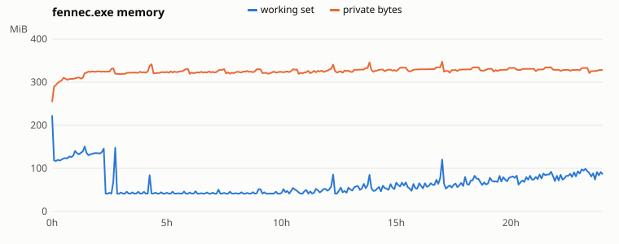
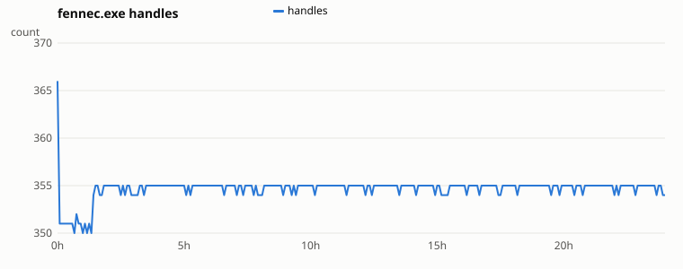

# Fennec 0.2.0 soak (REL-05) — summary

**Result: passed.** The generated verdict below says FAIL only because of one crash file that came from a process outside the test: a REL-02 `fennec-service -debug-panic` test job re-run by the VM's scheduled tasks. The tested processes never crashed or exited, and every other criterion passed (see "Crash file" below).

## Setup

| Item | Value |
|---|---|
| Build | `5f4c248`, standard MSI (`fennec-0.2.0-x64-standard.msi`, SHA256 `f6087d5e…`), installed in `C:\Program Files\Fennec`; `FennecService` running |
| Machine | Windows Server 2022 Datacenter VM, 10 vCPU, 32 GB, Chinese UI |
| Process | `fennec.exe -instance soak -startup` (elevated Administrator, hidden in the tray); started by `tools/soak/soak.ps1 -Detach` |
| Run | 2026-10-14 22:40:31 → 2026-10-15 22:40:34 (24.00 h), 289 samples every 5 min |
| Indexes | NTFS volumes C:, D:, R: read directly (`mode="direct"`; the built-in Administrator always has a full token, so the service only served as a sampled bystander); no folder indexes, no file lists; property and content indexes off (defaults: `props.fnx` 128 B, `content.fnx` 168 B); index journal on (default, `journal.tsv` 65 MB at the end) |
| Index size | 724,671 entries at start, 726,653 at the end (range 717,339 – 741,789); rows including tombstones 729,444 – 924,865 |
| Load | `soak-churn`: 50 changes/s (create/rename/delete, roughly a third each) below `D:\soak`, a folder that always has 10,000 children, and a 15,000-entry subtree deleted and recreated every 15 min |
| Compactions | 15 (one every ~95 min), each removing 184,904 – 199,274 rows in 215 – 471 ms |

## REL-05 criteria

| Criterion | Result |
|---|---|
| RSS growth < 10 % in 24 h | Working set −31.9 % (first vs last hour; Windows trims it, 41 – 223 MiB). Private bytes +9.8 % for the same windows: the first hour is before the first compaction, while the freshly loaded index is still collecting tombstones. The valleys after each compaction (below) are flat: **320.7 → 321.1 MiB**, least-squares slope **+0.26 MiB/h** (+6.3 MiB over 24 h). |
| Handles stable | 350 – 366; first vs last hour 352.2 → 354.8 (+0.7 %); no step at any of the 15 compactions |
| No crash files | No crash file from the tested processes: fennec (pid 14976) and fennec-service (pid 5016) ran the full 24 h without a restart. The one crash file in the logs folders belongs to another process (see below). |
| Other | CPU 0.5 % of one core on average (max 1.75 % per 5-min sample); threads 34; service 9.8 MiB working set, 100 handles, 0.0 % CPU throughout |

## Crash file

`C:\ProgramData\Fennec\logs\crash-20261014-235904-fennec-service.log`: `pid: 17064`, `message: -debug-panic: deliberate panic in fennec-service (crash report test)`.

The VM helper started every build/test job as a scheduled task with a one-time trigger at 23:59 on the day it was created, and never deleted the tasks. At 23:59 on 2026-10-14 every job created that day (about 40: builds, test suites, benchmarks and the REL-02 crash tests) ran once more, alongside the soak. One of them ran `fennec-service -debug-panic` as a separate process, which wrote this report into the shared service logs folder.

Fixes:
- All 85 leftover tasks were removed, and the helper now deletes each task when its job ends.
- `soak.ps1` now counts only crash reports whose `pid:` belongs to a soaked process (`e1a98bf`).

The extra load from those jobs fell on 2026-10-15 00:00, near the start of the run.

## Private bytes, rough breakdown

These were measured after the soak, each part in a separate process, so the figures are differences between processes, not a heap profile.

| Part | MiB | How measured |
|---|---|---|
| Process runtime (Rust std, threads, CRT) | ≈ 5 | `fennec-service` (no UI, no index): 5.0 private |
| UI: window, GL context, fonts and font atlas (CJK), egui, thread pools | ≈ 124 | instance with an empty index, hidden: 128.7, minus the runtime |
| Index | ≈ 157 | the soak's `index.fnx` (726,653 entries) loaded, hidden: 285.5, minus the empty instance. Of this, 104 MiB is the index store heap (`heap_mib=104` at "index ready"); the rest is path caches, sort ranks, the empty search's 726k-id result set, and USN/journal buffers |
| Visible window: rows, icons, thumbnail textures | +10 (empty index), +20 (soak index) | visible minus hidden: 138.5 / 305.0 |
| Property and content stores | 0 | disabled (defaults) |
| Other, during the soak | ≈ 35 – 60 | the soak's 321 – 347 minus 285.5: tombstone rows between compactions (up to ~190k) and allocator slack. This is what the compactions give back; it is the same at the 15th valley as at the 1st. |

---

## Generated report (`soak-churn report`)

Run: 2026-10-14 22:40:31 → 2026-10-15 22:40:34 (24.00 h, 289 samples). Generated by `soak-churn report` from the `soak.ps1` CSV.

Overall: **FAIL**

## REL-05 criteria

| Criterion | Measured | Result |
|---|---|---|
| fennec RSS (working set) growth < 10 %, first vs last window mean | 130.8 → 89.1 MiB (-31.9 %) | PASS |
| fennec private bytes growth < 10 % (leak check; the working set can be trimmed) | 299.0 → 328.3 MiB (+9.8 %) | PASS |
| fennec handles stable (< 10 % or ≤ 50 more) | 352.2 → 354.8 (+0.7 %) | PASS |
| No crash files | 1 | FAIL |
| fennec never exited | 0 restarts, missing in 0 samples | PASS |
| Live compaction ran | 15 times | PASS |
| Duration ≥ 24 h | 24.00 h | PASS |

Windows: first = the 1 h after a 0 min warm-up, last = the final 1 h.

## Summary

| Series | First | Last | Min | Max | Mean | Raw first→last | Window growth | Slope/h |
|---|---|---|---|---|---|---|---|---|
| fennec working set (MiB) | 223.1 | 86.0 | 41.2 | 223.1 | 65.5 | -61.5 % | -31.9 % | -0.07 |
| fennec private bytes (MiB) | 253.8 | 328.5 | 253.8 | 347.4 | 325.3 | +29.4 % | +9.8 % | +0.65 |
| fennec handles | 366.0 | 354.0 | 350.0 | 366.0 | 354.6 | -3.3 % | +0.7 % | +0.04 |
| fennec threads | 43.0 | 34.0 | 34.0 | 43.0 | 34.0 | -20.9 % | -2.6 % | -0.01 |
| service working set (MiB) | 9.8 | 9.8 | 9.8 | 9.8 | 9.8 | +0.0 % | +0.0 % | -0.00 |
| service handles | 101.0 | 100.0 | 100.0 | 101.0 | 100.0 | -1.0 % | -0.1 % | -0.00 |
| index entries | 724671.0 | 726653.0 | 717339.0 | 741789.0 | 737933.4 | +0.3 % | n/a | +285.84 |
| index entries below the churn root | 45044.0 | 30069.0 | 30069.0 | 45305.0 | 43358.8 | -33.2 % | n/a | -44.57 |
| index rows incl. tombstones (at DB saves) | 729444.0 | 807697.0 | 729444.0 | 924865.0 | 828399.5 | +10.7 % | n/a | +589.20 |

CPU average (Δ CPU time / Δ wall time, % of one core): fennec 0.5 %, service 0.0 %. Service: 0 restarts, missing in 0 samples. New crash files during the run: 1.

## Private bytes after each compaction (valleys)

| Compaction | At | Valley MiB |
|---|---|---|
| 1 | 01:25:09 | 320.7 |
| 2 | 03:00:03 | 318.6 |
| 3 | 04:30:03 | 320.7 |
| 4 | 06:00:02 | 319.2 |
| 5 | 07:45:04 | 319.7 |
| 6 | 09:25:05 | 319.5 |
| 7 | 10:45:03 | 319.0 |
| 8 | 12:40:02 | 322.0 |
| 9 | 14:00:05 | 323.9 |
| 10 | 15:35:01 | 324.5 |
| 11 | 17:20:03 | 322.1 |
| 12 | 19:15:02 | 324.8 |
| 13 | 21:05:05 | 325.4 |
| 14 | 22:10:01 | 326.1 |
| 15 | 23:25:03 | 321.1 |

Least-squares slope of the valleys: +0.26 MiB/h over 22.0 h (+6.3 MiB projected over 24 h); first → last valley 320.7 → 321.1 MiB.

## Samples (hourly; full data in the CSV)

| Time | Elapsed | WS MiB | Private MiB | CPU % | Handles | Threads | Svc WS MiB | Svc handles | Entries | Soak entries | Rows | Compactions | Crash | Note |
|---|---|---|---|---|---|---|---|---|---|---|---|---|---|---|
| 2026-10-14 22:40:31 | 00:00:00 | 223.1 | 253.8 |  | 366 | 43 | 9.8 | 101 | 724671 | 45044 |  | 0 | 0 | start |
| 2026-10-14 23:40:36 | 01:00:05 | 140.4 | 308.6 | 0.4 | 350 | 34 | 9.8 | 100 | 724656 | 45025 | 829654 | 0 | 0 |  |
| 2026-10-15 00:40:33 | 02:00:03 | 135.1 | 325.2 | 0.6 | 355 | 34 | 9.8 | 100 | 732090 | 37979 | 831863 | 1 | 1 |  |
| 2026-10-15 01:40:33 | 03:00:03 | 43.9 | 318.6 | 0.4 | 354 | 34 | 9.8 | 100 | 732717 | 38274 | 749719 | 2 | 1 |  |
| 2026-10-15 02:40:33 | 04:00:03 | 45.4 | 323.3 | 0.4 | 355 | 34 | 9.8 | 100 | 732166 | 38235 | 869708 | 2 | 1 |  |
| 2026-10-15 03:40:33 | 05:00:03 | 43.4 | 323.5 | 0.5 | 355 | 34 | 9.8 | 100 | 731148 | 37205 | 804763 | 3 | 1 |  |
| 2026-10-15 04:40:33 | 06:00:02 | 43.9 | 319.2 | 0.5 | 355 | 34 | 9.8 | 100 | 727796 | 33547 | 924865 | 4 | 1 |  |
| 2026-10-15 05:40:32 | 07:00:02 | 43.6 | 323.8 | 0.4 | 355 | 34 | 9.8 | 100 | 725111 | 30408 | 859209 | 4 | 1 |  |
| 2026-10-15 06:40:32 | 08:00:02 | 42.5 | 323.1 | 0.5 | 354 | 34 | 9.8 | 100 | 732514 | 30769 | 780024 | 5 | 1 |  |
| 2026-10-15 07:40:32 | 09:00:01 | 51.7 | 329.9 | 0.5 | 355 | 34 | 9.8 | 100 | 728554 | 32664 | 900070 | 5 | 1 |  |
| 2026-10-15 08:40:32 | 10:00:01 | 42.9 | 323.8 | 0.5 | 355 | 34 | 9.8 | 100 | 735465 | 39731 | 835009 | 6 | 1 |  |
| 2026-10-15 09:40:31 | 11:00:01 | 47.4 | 322.2 | 0.5 | 355 | 34 | 9.8 | 100 | 739087 | 43488 | 769993 | 7 | 1 |  |
| 2026-10-15 10:40:31 | 12:00:00 | 48.1 | 326.6 | 0.5 | 355 | 34 | 9.8 | 100 | 739562 | 44943 | 889939 | 7 | 1 |  |
| 2026-10-15 11:40:36 | 13:00:05 | 51.2 | 324.0 | 0.5 | 355 | 34 | 9.8 | 100 | 739642 | 45027 | 810584 | 8 | 1 |  |
| 2026-10-15 12:40:36 | 14:00:05 | 47.8 | 323.9 | 0.5 | 355 | 34 | 9.8 | 100 | 741416 | 44938 | 747466 | 9 | 1 |  |
| 2026-10-15 13:40:36 | 15:00:05 | 66.7 | 325.9 | 0.4 | 355 | 34 | 9.8 | 100 | 741554 | 45083 | 867655 | 9 | 1 |  |
| 2026-10-15 14:40:35 | 16:00:05 | 65.2 | 329.6 | 0.5 | 355 | 34 | 9.8 | 100 | 741422 | 44945 | 802119 | 10 | 1 |  |
| 2026-10-15 15:40:35 | 17:00:05 | 120.3 | 347.4 | 0.5 | 355 | 34 | 9.8 | 100 | 741776 | 45295 | 922351 | 10 | 1 |  |
| 2026-10-15 16:40:35 | 18:00:04 | 80.0 | 329.5 | 0.5 | 355 | 34 | 9.8 | 100 | 741549 | 45079 | 843063 | 11 | 1 |  |
| 2026-10-15 17:40:35 | 19:00:04 | 65.1 | 330.7 | 0.5 | 355 | 34 | 9.8 | 100 | 741562 | 45088 | 777537 | 12 | 1 |  |
| 2026-10-15 18:40:35 | 20:00:04 | 79.8 | 333.0 | 0.5 | 355 | 34 | 9.8 | 100 | 741595 | 45112 | 897695 | 12 | 1 |  |
| 2026-10-15 19:40:35 | 21:00:04 | 74.4 | 330.8 | 0.5 | 355 | 34 | 9.8 | 100 | 741623 | 45138 | 832057 | 13 | 1 |  |
| 2026-10-15 20:40:34 | 22:00:04 | 82.6 | 328.5 | 0.5 | 354 | 34 | 9.8 | 100 | 741598 | 45020 | 753633 | 14 | 1 |  |
| 2026-10-15 21:40:35 | 23:00:04 | 88.1 | 327.4 | 0.4 | 355 | 34 | 9.8 | 100 | 741433 | 44853 | 873551 | 14 | 1 |  |
| 2026-10-15 22:40:34 | 24:00:04 | 86.0 | 328.5 | 0.4 | 354 | 34 | 9.8 | 100 | 726653 | 30069 | 807697 | 15 | 1 | end: duration reached |
